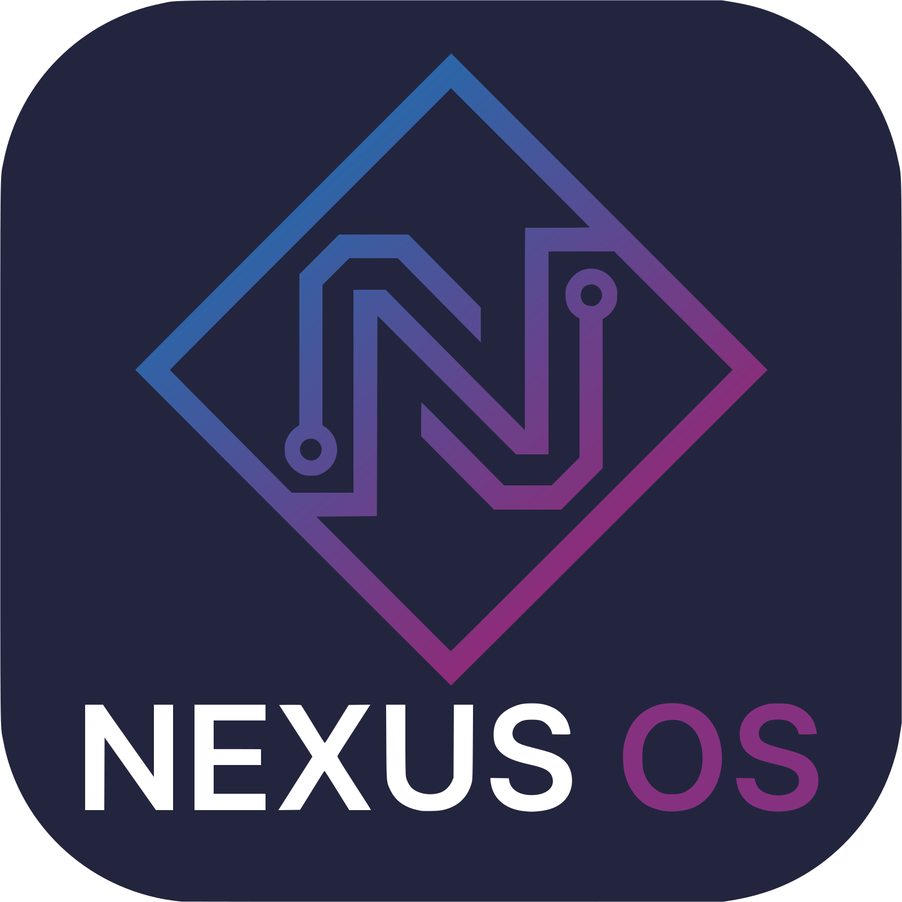
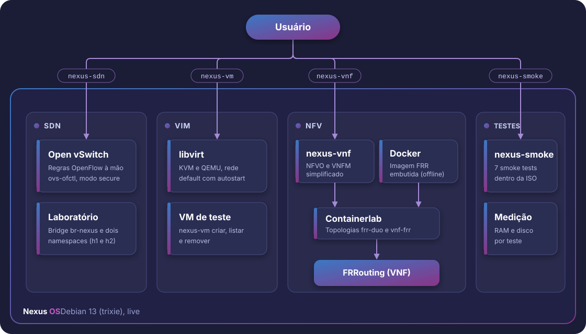

<div align="center">



# Nexus OS

**Distro Linux para virtualização de redes (SDN e NFV), baseada em Debian 13.**


-a80030)
-purple)

[Estado atual](#estado-atual) · [Arquitetura](#arquitetura) · [Como gerar a ISO](#como-gerar-a-iso) · [Usar a ISO](#usar-a-iso-integrada) · [Requisitos](#requisitos-medidos-da-rc1) · [Testes](#testes) · [Documentação](#documentação)

</div>

---

## Sobre

O Nexus OS é uma remasterização do Debian 13 (trixie) gerada com **live-build**, não uma distro construída do zero. A ISO é *live* e traz, já instalados e testados, os componentes para montar laboratórios de redes definidas por software (SDN) e de virtualização de funções de rede (NFV): switch virtual com regras OpenFlow, virtualização com KVM/QEMU, contêineres com imagem offline, roteamento com FRRouting, topologias com Containerlab e um script de orquestração da VNF.

Projeto Integrador acadêmico, em desenvolvimento.

## Estado atual

A **RC1** é a primeira ISO integrada: só o núcleo, **sem ambiente gráfico** (o desktop está previsto para a RC2). Detalhes, medições e riscos em [docs/rc1.md](docs/rc1.md).

| Componente | Versão na ISO | Como usar | Smoke test |
| --- | --- | --- | --- |
| SDN: Open vSwitch | `openvswitch-switch` 3.5.0-1+b1 | `nexus-sdn up\|flows\|down` | `sdn` |
| VIM: KVM/QEMU e libvirt | libvirt 11.3.0-3+deb13u3, QEMU 1:10.0.13+ds-0+deb13u1 | `nexus-vm criar\|listar\|remover` | `virtualizacao`, `libvirt` |
| Contêineres | `docker.io` 26.1.5+dfsg1-9+deb13u1, imagem `quay.io/frrouting/frr:10.7.1` embutida (sem internet) | `docker` | `containers` |
| VNF: FRRouting | pacote `frr` 10.3-3+deb13u1 | `vtysh` | `frr` |
| Topologia: Containerlab | 0.81.1 | `containerlab deploy -t ...` | `nfv` |
| NFVO/VNFM simplificado | script `nfv/nexus-vnf.sh` | `nexus-vnf up\|status\|down` | `orquestracao` |

Fora da RC1: OpenDaylight (opcional, só depois que o núcleo estiver validado), GNS3 (apenas documentado em [docs/gns3.md](docs/gns3.md), não entra na ISO) e o ambiente gráfico (RC2).

## Arquitetura

<p align="center">
  
</p>

## Versões confirmadas (21/10/2026)

- Debian 13 (trixie), versão pontual 13.7
- live-build 20250505+deb13u1 (`lb --version`)
- Open vSwitch 3.5.0-1+b1 (pacote `openvswitch-switch` no trixie/main)

Como foram medidas: [docs/ambiente-de-build.md](docs/ambiente-de-build.md).

## Stack

- Controlador SDN: OpenDaylight, via OpenFlow, com Open vSwitch
- VIM: KVM/QEMU + libvirt
- VNF de exemplo: FRRouting
- Orquestração NFVO/VNFM: representada de forma simplificada (scripts/Ansible)
- Topologia de demonstração: Containerlab (principal) e GNS3 (secundário)

## Como gerar a ISO

**Exige** Linux (VM Debian 13), usuário com `sudo`, Docker, internet e espaço livre: o build limpo ocupou 5383 MiB (medido em 26/10/2026, veja [docs/rc1.md](docs/rc1.md)).
Preparo da VM: [docs/ambiente-de-build.md](docs/ambiente-de-build.md). Resultado esperado e medições: [docs/iso-poc.md](docs/iso-poc.md).

1. Clone o repositório no disco do Linux (nunca em pasta compartilhada com o Windows nem em `/mnt/*`):

   ```bash
   git clone https://github.com/MixuriM/nexus-os.git
   cd nexus-os
   ```

2. Gere a ISO (516 s medidos com KVM na VM do Hyper-V; o log fica em `live-build/build.log`):

   ```bash
   sudo scripts/build-iso.sh
   ```

   A saída são `dist/nexus-os-poc-amd64.iso` e `dist/nexus-os-poc-amd64.iso.sha256`. Esses arquivos não vão para o Git.

3. Teste a ISO (confere o SHA256 e inicia a ISO no QEMU até aparecer `login:`):

   ```bash
   tests/iso.sh dist/nexus-os-poc-amd64.iso
   ```

4. Antes de commitar, rode `tests/lint-repo.sh`.

> **Aviso:** o live-build deve ser executado em Debian ou Ubuntu, com root e sistema de arquivos Linux. Não builde em pasta Windows. Veja [docs/ambiente-de-build.md](docs/ambiente-de-build.md).

## Usar a ISO integrada

1. Inicie a ISO numa VM (testado: QEMU com KVM; o Hyper-V está descrito em [docs/rc1.md](docs/rc1.md)) com pelo menos **1536 MiB de RAM** e a ISO como CD. Na tela do isolinux, aperte Enter.
2. Entre com o usuário `user` e a senha `live` (credencial pública da Debian Live, de laboratório). O `sudo` não pede senha.
3. Use os comandos abaixo.

| Comando | O que faz | Guia |
| --- | --- | --- |
| `sudo nexus-sdn up\|flows\|down` | Laboratório Open vSwitch: bridge `br-nexus` em modo `secure` e dois namespaces, com regras OpenFlow manuais | [docs/sdn.md](docs/sdn.md) |
| `nexus-vm criar <nome>\|listar\|remover <nome>` | VMs de teste do libvirt (funciona sem `sudo` para quem está no grupo `libvirt`, como o `user`) | [docs/virtualizacao.md](docs/virtualizacao.md) |
| `sudo nexus-vnf up\|status\|down` | Ciclo da VNF FRR sobre o Containerlab | [docs/nfv.md](docs/nfv.md) |
| `sudo containerlab deploy -t /usr/share/nexus-os/labs/containerlab/frr-duo.clab.yml` | Topologia de demonstração: dois nós FRR trocando rotas por OSPF | [docs/nfv.md](docs/nfv.md) |
| `sudo nexus-smoke <nome>\|all` | Smoke tests dos componentes dentro da ISO, com medição de RAM e disco | [docs/integracao-iso.md](docs/integracao-iso.md) |

## Requisitos medidos da RC1

Medidos com KVM, em boot live com os serviços ativos (método e limitações em [docs/requisitos.md](docs/requisitos.md)).

| Item | Valor |
| --- | --- |
| RAM recomendada | **1536 MiB** (validada com o `all` completo) |
| RAM em repouso e de pico | 796 MiB e 813 MiB (guest de 4096 MiB) |
| Mínimo de RAM do smoke `containers` | 896 MiB (768 MiB falha) |
| Disco | a live não usa disco do guest; raiz em memória 24 MiB e Docker 193 MiB |
| ISO | 921698304 bytes (879 MiB) |
| Boot até `login:` | 27 s com KVM |
| Build limpo | 516 s |

## Testes

Cada script imprime `OK:` ou `FALHA:` e sai com código diferente de zero em falha. Lista completa em [tests/README.md](tests/README.md).

| Teste | O que cobre |
| --- | --- |
| `tests/lint-repo.sh` | CRLF, travessão, imagens e pacotes versionados, segredos, sintaxe e `shellcheck`. Roda no Git Bash e no Linux |
| `tests/iso.sh <iso>` | SHA256 da ISO e boot no QEMU até o `login:` |
| `tests/iso-smoke.sh <iso> <nome>\|all` | Inicia a ISO sem rede e roda dentro dela os 7 smokes: `sdn`, `virtualizacao`, `libvirt`, `containers`, `frr`, `nfv` e `orquestracao` |
| `tests/run-fase2.sh [iso]` | Verificação do repositório, boot e laboratórios de Open vSwitch, libvirt e FRR com Containerlab, parando no primeiro erro |
| `tests/requisitos.sh` | Confere a tabela de requisitos e o SHA256 da RC1 |
| `tests/docs.sh` | Documentos por componente, índice, links e seções do manual e do GNS3. Roda no Git Bash e no Linux |
| `tests/manual.sh <iso>` | Executa os blocos do [manual](docs/manual.md) dentro da ISO, sem rede |
| `tests/run-fase3.sh [iso]` | `lint-repo`, `docs`, `iso`, `iso-smoke all`, `requisitos` e `manual`, parando no primeiro erro |

Validação da RC1 (com KVM): `all` com 7 de 7 testes em 69 s (4096 MiB) e 73 s (1536 MiB). Numa VM do Hyper-V sem KVM, 6 de 7 na primeira execução, com uma falha intermitente do `libvirt` ([issue 35](https://github.com/MixuriM/nexus-os/issues/35)).
Para testar a documentação do zero: [checklist](docs/checklist-teste-documentacao.md).

## Estrutura

```text
nexus-os/
├── assets/          logo e diagrama de arquitetura (SVG)
├── docs/            documentação técnica (índice em docs/README.md)
├── live-build/      configuração da ISO (receita em auto/ e config/)
├── sdn/             laboratório Open vSwitch (lab-ovs.sh, flows/)
├── nfv/             libvirt (nexus-vm), FRR de exemplo e orquestração (nexus-vnf.sh)
├── labs/
│   ├── containerlab/  topologias frr-duo (dois nós FRR e OSPF) e vnf-frr (uma VNF)
│   └── gns3/          só documentado (docs/gns3.md), sem topologia
├── ansible/         sem conteúdo ainda
├── scripts/         build-iso.sh, prepare-offline.sh, stage-iso-files.sh e sync-branches.sh
└── tests/           testes da ISO e dos componentes
```

## Documentação

Índice completo em [docs/README.md](docs/README.md).

- Ambiente: [build](docs/ambiente-de-build.md), [VM no Hyper-V com KVM](docs/hyperv.md), [ISO da prova de conceito](docs/iso-poc.md)
- Componentes: [SDN](docs/sdn.md), [virtualização](docs/virtualizacao.md), [contêineres](docs/containers.md), [NFV](docs/nfv.md)
- Integração: [como a ISO é montada](docs/integracao-iso.md), [RC1](docs/rc1.md), [requisitos de hardware](docs/requisitos.md)
- Uso: [manual v1](docs/manual.md) e [GNS3, só documentado](docs/gns3.md)

## Limitações conhecidas

Acompanhadas como issues no GitHub.

- O VirtualBox em CPU AMD não oferece KVM aninhado e derruba a VM de build (issue 25); o ambiente com KVM é o Hyper-V.
- Abaixo de cerca de 896 MiB de RAM o Docker não carrega a imagem FRR (issue 31).
- O `nexus-smoke.service` executa como root o conteúdo de um CD com rótulo `NEXUS_SMOKE`; a decisão de removê-lo ou condicioná-lo fica para o congelamento da ISO (issue 32).
- A RAM em repouso varia entre execuções (issue 33) e o desligamento da live pede ENTER (issue 34).
- Sem ambiente gráfico na RC1.

## Fluxo de trabalho

Branches, PRs e revisão: [docs/fluxo-de-trabalho.md](docs/fluxo-de-trabalho.md).

Integrantes abrem PR somente para a `marcos`, nunca direto para a `main`. Só o revisor final faz merge, e os PRs entram com "Rebase and merge" (histórico linear). Depois de cada merge, o revisor final roda `scripts/sync-branches.sh` para alinhar a `marcos` e as branches pessoais com a `main`.
Cada integrante atualiza a própria branch com:

```bash
git fetch origin
git switch <sua-branch>
git merge --no-edit origin/main
```

## Licença

GPL-3.0-or-later. Veja [LICENSE](LICENSE).
