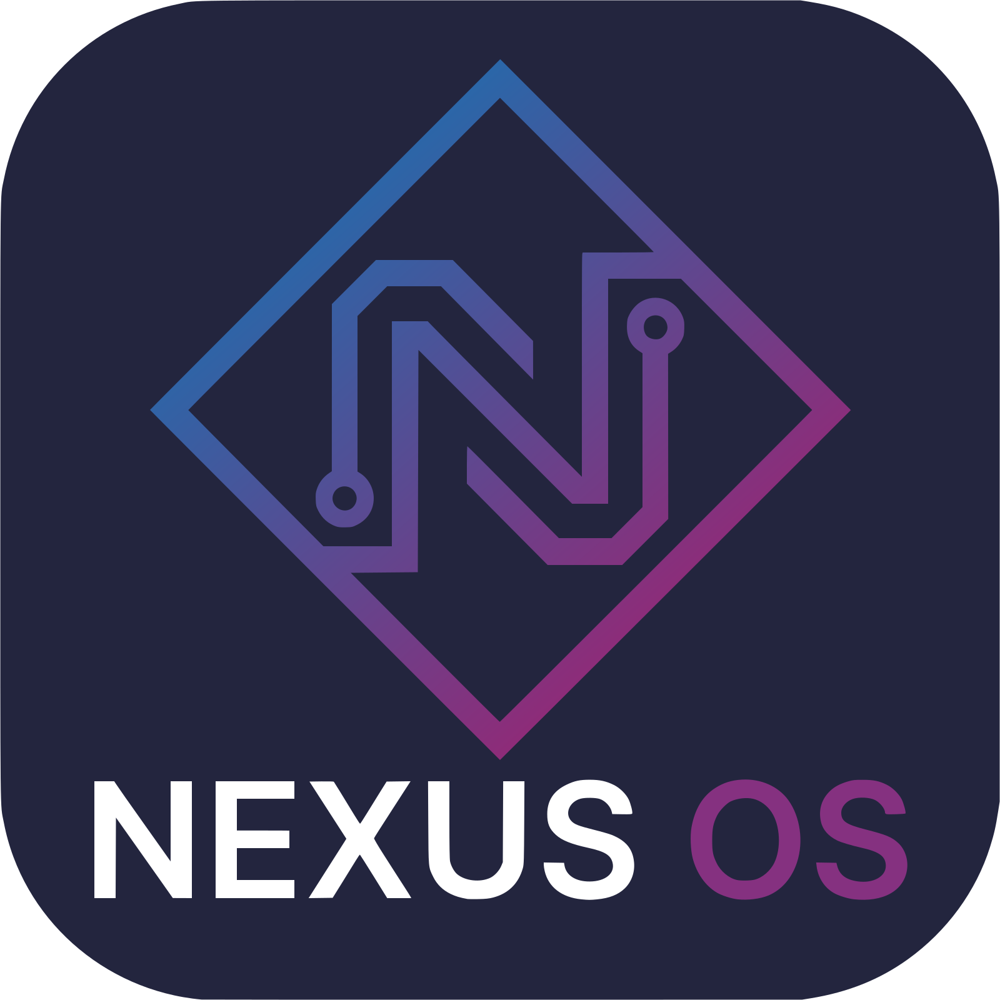
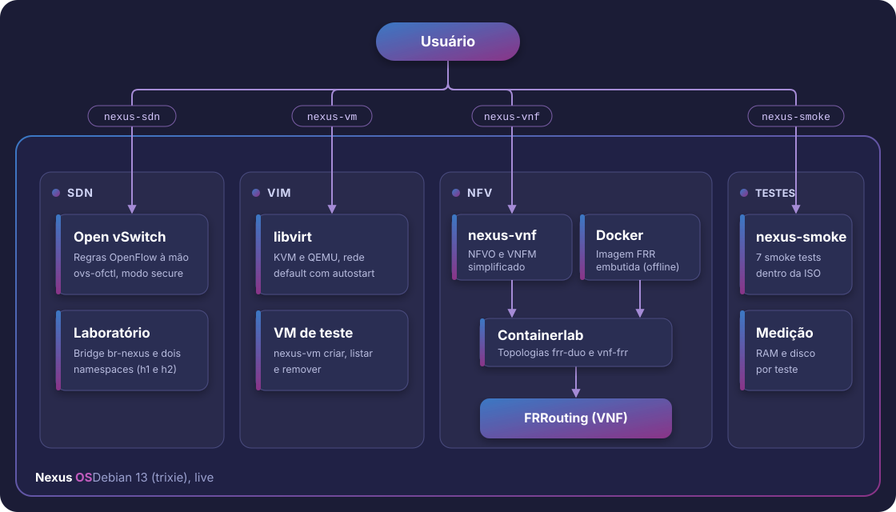

<div align="center">



# Nexus OS

**Distro Linux para virtualização de redes (SDN e NFV), baseada em Debian 13.**


-a80030)


[Estado atual](#estado-atual) · [Arquitetura](#arquitetura) · [Como gerar a ISO](#como-gerar-a-iso) · [Usar a ISO](#usar-a-iso-integrada) · [Requisitos](#requisitos-medidos-da-rc1) · [Testes](#testes) · [Documentação](#documentação)

</div>

---

## Sobre

O Nexus OS é uma remasterização do Debian 13 (trixie) gerada com **live-build**, não uma distro construída do zero. A ISO é *live* e traz, já instalados e testados, os componentes para montar laboratórios de redes definidas por software (SDN) e de virtualização de funções de rede (NFV): switch virtual com regras OpenFlow, virtualização com KVM/QEMU, contêineres com imagem offline, roteamento com FRRouting, topologias com Containerlab e um script de orquestração da VNF.

Projeto Integrador acadêmico, em desenvolvimento.

## Estado atual

A **RC1** é a primeira ISO integrada, só com o núcleo e sem ambiente gráfico ([docs/rc1.md](docs/rc1.md)). A **RC2** soma a ela o **desktop XFCE** com login automático do `user`, 10 atalhos para os componentes (F3.15 e F3.16, [docs/gui.md](docs/gui.md)), a identidade visual do Nexus OS (F3.17, [docs/branding.md](docs/branding.md)), a barra única embaixo com o menu estilo macOS, o português do Brasil e programas prontos para uso (LibreOffice, Wireshark, VLC, GIMP, Inkscape, KeePassXC, Thunderbird, GParted, Geany, FileZilla, Audacity e mais). A **rodada 5 da RC2** (03/11/2026) trouxe as melhorias pedidas depois do teste no Hyper-V: menu `whiskermenu` aberto também pela tecla Windows, `docklike` com os aplicativos fixados e as janelas só com ícone, centralizados na barra (`nexus-barra` leva para a esquerda), relógio com a hora em cima e a data embaixo, ícone da bateria só em notebook, ícones novos no estilo do Nexus OS e a opção de usar o ícone original de cada aplicativo (`nexus-icone`, `nexus-icones` e a janela "Ícones dos aplicativos"), GIMP com o nome curto, 39 aplicativos novos e [dicas de copiar e colar no terminal](docs/manual.md). Não há loja de aplicativos: a ISO é live e o que se instala some ao desligar.

A **RC3** (`v1.0.0-rc3`, 12/11/2026) soma o menu de boot de 3 entradas e sem contagem, a tela de carregamento com a logo e uma roda animada (Plymouth) e a demonstração guiada `nexus-demo` ([docs/demo.md](docs/demo.md)). Ao testar a RC3 gravada em um pendrive com o Rufus, ela subiu em um PC (Ryzen 7 5700X, GeForce RTX 2060) e falhou em um notebook (Ryzen 7 5825U, Radeon integrada). Quatro defeitos de hardware real foram corrigidos: o firmware da GPU AMD (`firmware-amd-graphics`; sem ele só o terminal subia), o papel de parede padrão do XFCE no lugar do Nexus OS (o `xfdesktop` lê o papel por nome de monitor), o brilho da tela quase no mínimo no notebook e o disco do Windows que não montava (o ícone de um volume não montado aparece com metade da opacidade). As correções saíram como `v1.0.0-rc3.1` a `v1.0.0-rc3.4`; detalhes em [docs/gui.md](docs/gui.md), seção "Notebook com GPU AMD".

**ISO mais recente:** a [`v1.0.0-rc3.4`](https://github.com/MixuriM/nexus-os/releases/tag/v1.0.0-rc3.4), `nexus-os-rc3.4-amd64.iso`, SHA256 `d9afcb00db65586b665a8c5373077cc4f672ec9f2005674dfba64e1410690a7c`, 2044821504 bytes (1950 MiB), commit `8004304`, anexada à release junto com o `.sha256`. Testes: smoke `desktop` (137 s, com KVM) e conferência no notebook e no PC; a bateria completa (`all`, T1 a T7 e `run-fase3`) rodou na RC3 original (`0a8cc302...`, com `all` em 225 s) e não foi repetida na `rc3.4`. Microcode da CPU e firmware de Wi-Fi ficam fora da ISO (o Wi-Fi de alguns notebooks pode não funcionar). Um arquivo de release do GitHub tem no máximo 2 GiB e a `rc3.4` fica cerca de 98 MiB abaixo disso ([docs/iso-poc.md](docs/iso-poc.md)). A RC4, otimizada, é a próxima.

**ISO da RC2 (congelada em 10/11/2026, tag `v1.0.0-rc2`):** `dist/nexus-os-rc2-amd64.iso`, SHA256 `cb13d258153162f4ebe6d1d81cf507357e754152b1eef27d3b33ac74d4be876e`, 1990639616 bytes (1898 MiB), build limpo do commit `480e5d8` ([docs/rc2.md](docs/rc2.md)). Testes: `tests/run-fase3.sh` com 9 testes e `all` com 4096 e 2560 MiB, com KVM; Hyper-V Geração 2 conferido à mão em 03/11/2026 (N1 a N20 passaram, com ressalvas registradas). **Falta** o teste no VirtualBox (rodada 2), que tem [passo a passo completo em docs/teste-virtualbox.md](docs/teste-virtualbox.md), e a execução do roteiro por uma segunda pessoa. O congelamento da ISO está em [docs/congelamento.md](docs/congelamento.md).

| Componente | Versão na ISO | Como usar | Smoke test |
| --- | --- | --- | --- |
| SDN: Open vSwitch | `openvswitch-switch` 3.5.0-1+b1 | `nexus-sdn up\|flows\|down` | `sdn` |
| VIM: KVM/QEMU e libvirt | libvirt 11.3.0-3+deb13u3, QEMU 1:10.0.13+ds-0+deb13u1 | `nexus-vm criar\|listar\|remover` | `virtualizacao`, `libvirt` |
| Contêineres | `docker.io` 26.1.5+dfsg1-9+deb13u1, imagem `quay.io/frrouting/frr:10.7.1` embutida (sem internet) | `docker` | `containers` |
| VNF: FRRouting | pacote `frr` 10.3-3+deb13u1 | `vtysh` | `frr` |
| Topologia: Containerlab | 0.81.1 | `containerlab deploy -t ...` | `nfv` |
| NFVO/VNFM simplificado | script `nfv/nexus-vnf.sh` | `nexus-vnf up\|status\|down` | `orquestracao` |
| Firmware da GPU AMD | `firmware-amd-graphics` 20250410-2 (área `non-free-firmware`; versão da página do pacote no Debian 13, não conferida na ISO) | automático: deixa o `amdgpu` iniciar em notebook Ryzen | só em hardware real |
| Desktop: XFCE | `xfce4` 4.20.1 com `lightdm` 1.32.0-6+b2, `firefox-esr` e `virt-manager` | login automático do `user`; menu e área de trabalho com os atalhos "Nexus OS" | `desktop` |
| Barra e menu | `xfce4-whiskermenu-plugin` 2.9.2-1, `xfce4-docklike-plugin` 0.4.3-1, `xfce4-power-manager-plugins` 4.20.0-1 | tecla Windows ou botão da logo; `nexus-barra centro|esquerda|alternar`; `nexus-icone` e `nexus-icones` | `desktop` |

Fora da ISO: OpenDaylight (opcional, só depois que o núcleo estiver validado) e GNS3 (apenas documentado em [docs/gns3.md](docs/gns3.md)).

O desktop é o **XFCE** com `lightdm`, escolhido por medição. Na ISO ele sobe sozinho no login do `user`: a sessão fica pronta 23 s depois do boot (rodada 4), com 1095 MiB de RAM em repouso e pico de 2006 MiB, e ISO de 1990639616 bytes (rodada 5; com KVM; sem KVM o smoke `desktop` também passa, mais lento). Na RC3 a sessão fica pronta em 18,7 s (mediana, com KVM). Comparação dos candidatos, atalhos, a barra, o menu e as medições em [docs/gui.md](docs/gui.md). **Sem loja de aplicativos (decisão do grupo):** programas instalados com `sudo apt install` na sessão somem ao desligar; o que se quer sempre fica na lista de pacotes da ISO (`live-build/config/package-lists/`).

## Arquitetura

<p align="center">
  
</p>

## Versões confirmadas (21/10/2026)

- Debian 13 (trixie), versão pontual 13.7
- live-build 20250505+deb13u1 (`lb --version`)
- Open vSwitch 3.5.0-1+b1 (pacote `openvswitch-switch` no trixie/main)

Como foram medidas: [docs/ambiente-de-build.md](docs/ambiente-de-build.md).

## Stack

- Controlador SDN: OpenDaylight, via OpenFlow, com Open vSwitch
- VIM: KVM/QEMU + libvirt
- VNF de exemplo: FRRouting
- Orquestração NFVO/VNFM: representada de forma simplificada (scripts/Ansible)
- Topologia de demonstração: Containerlab (principal) e GNS3 (secundário)

## Como gerar a ISO

**O que é:** a ISO é gerada por um único script (`scripts/build-iso.sh`) numa máquina Linux. O passo a passo completo, com o que deve aparecer e o que fazer se algo falhar, está na seção "Gerar a ISO" do [manual v2](docs/manual.md); abaixo está o resumo.

**Você precisa de:** Linux (VM Debian 13), usuário com `sudo`, Docker, internet e espaço livre: o build limpo da RC2 ocupou 14098 MiB no clone (medido em 09/11/2026, veja [docs/rc2.md](docs/rc2.md)); o da RC1, sem desktop, 5383 MiB (26/10/2026, [docs/rc1.md](docs/rc1.md)). Deixe pelo menos 20 GiB livres. Preparo da VM: [docs/ambiente-de-build.md](docs/ambiente-de-build.md) (com KVM no Hyper-V: [docs/hyperv.md](docs/hyperv.md)). Resultado esperado e medições: [docs/iso-poc.md](docs/iso-poc.md).

### Passo 1: clonar o repositório

**Onde:** terminal do Linux, no disco do Linux (nunca em pasta compartilhada com o Windows nem em `/mnt/*`).

```bash
git clone https://github.com/MixuriM/nexus-os.git
cd nexus-os
```

**Por quê:** baixa o código e entra na pasta; os comandos seguintes rodam dentro dela. **Deve aparecer:** o progresso do download, sem erro. **Se não aparecer:** `Could not resolve host` indica falta de internet.

### Passo 2: gerar a ISO

```bash
sudo scripts/build-iso.sh
```

**Por quê:** monta a ISO com o live-build (de 19 a 23 minutos com KVM na RC2; 516 s medidos na RC1 sem desktop); o log fica em `live-build/build.log`. **Deve aparecer:** `P: Build completed successfully` e `OK: dist/nexus-os-poc-amd64.iso, <bytes> bytes, <segundos> s`. A saída são `dist/nexus-os-poc-amd64.iso` e `dist/nexus-os-poc-amd64.iso.sha256`; esses arquivos não vão para o Git. **Se não aparecer:** `FALHA: precisa de root` (faltou o `sudo`), `FALHA: o build não roda em /mnt/*` (clone em pasta do Windows) ou `FALHA: o build falhou, veja live-build/build.log` (leia o fim do log).

### Passo 3: testar a ISO

```bash
tests/iso.sh dist/nexus-os-poc-amd64.iso
```

**Por quê:** confere o SHA256 e inicia a ISO no QEMU até aparecer `login:`. **Deve aparecer:** `OK: ISO chegou ao login ... com KVM, SHA256 conferido`. **Se não aparecer:** `FALHA: SHA256 da ISO não confere` (ISO corrompida: gere de novo) ou `FALHA: login: não apareceu em ... s` (a ISO não inicia: relate).

### Passo 4: conferir o repositório antes de commitar

```bash
tests/lint-repo.sh
```

**Deve aparecer:** `OK: lint-repo, ...`.

> **Aviso:** o live-build deve ser executado em Debian ou Ubuntu, com root e sistema de arquivos Linux. Não builde em pasta Windows. Veja [docs/ambiente-de-build.md](docs/ambiente-de-build.md).

## Usar a ISO integrada

**O que é:** a ISO é *live*: inicia na memória, sem instalar nada. O passo a passo completo (QEMU, Hyper-V e VirtualBox, com o que deve aparecer em cada passo) está nas seções "Iniciar a ISO" e "Ambiente gráfico" do [manual v2](docs/manual.md); abaixo está o resumo.

### Passo 1: iniciar a ISO numa VM com vídeo

Teste a ISO numa VM com vídeo (testado: QEMU com KVM; o Hyper-V Geração 1 e 2 e o VirtualBox estão descritos em [docs/manual.md](docs/manual.md), [docs/rc1.md](docs/rc1.md) e [docs/teste-virtualbox.md](docs/teste-virtualbox.md)) com **2560 MiB de RAM** (a recomendada com o desktop; o mínimo medido é 1792 MiB, veja [docs/requisitos.md](docs/requisitos.md)) e a ISO anexada à VM. **Por quê:** o desktop e os contêineres usam memória. **Deve aparecer:** o menu de boot do Nexus OS com 3 entradas (não inicia sozinho: escolha com as setas e aperte Enter), a tela de carregamento com a logo e uma roda girando e, depois de cerca de 25 s com KVM, o desktop XFCE já logado como `user`. A entrada "modo de demonstração" abre a demonstração guiada (veja [docs/demo.md](docs/demo.md)). **Se não aparecer:** veja a seção "Problemas no desktop" do manual. **Onde baixar:** as ISOs ficam anexadas às [releases](https://github.com/MixuriM/nexus-os/releases) (a mais recente é a `v1.0.0-rc3.4`); confira o SHA256 com `sha256sum -c <arquivo>.sha256`. **Máquina física:** grave a ISO em um pendrive (por exemplo, com o Rufus, no Windows) e inicie por ele; foi testado em 12/11/2026 em um notebook e em um PC.

**Internet:** no QEMU use `-nic user`; no Hyper-V, a VM criada sem rede precisa de `Connect-VMNetworkAdapter -VMName <vm> -SwitchName "Default Switch"` (comandos completos em [docs/manual.md](docs/manual.md), seção "Ambiente gráfico").

### Passo 2: usar os componentes

Use o menu "Nexus OS" ou os ícones da área de trabalho, ou abra um terminal (duplo clique em **Terminal do Nexus OS**). Se a sessão pedir login: usuário `user` e senha `live` (credencial pública da Debian Live, de laboratório). O `sudo` não pede senha. Os atalhos chamam os comandos abaixo; no terminal use os comandos diretamente. **Deve aparecer** em cada comando o que está descrito no guia da última coluna.

| Comando | O que faz | Guia |
| --- | --- | --- |
| `sudo nexus-sdn up\|flows\|down` | Laboratório Open vSwitch: bridge `br-nexus` em modo `secure` e dois namespaces, com regras OpenFlow manuais | [docs/sdn.md](docs/sdn.md) |
| `nexus-vm criar <nome>\|listar\|remover <nome>` | VMs de teste do libvirt (funciona sem `sudo` para quem está no grupo `libvirt`, como o `user`) | [docs/virtualizacao.md](docs/virtualizacao.md) |
| `sudo nexus-vnf up\|status\|down` | Ciclo da VNF FRR sobre o Containerlab | [docs/nfv.md](docs/nfv.md) |
| `sudo containerlab deploy -t /usr/share/nexus-os/labs/containerlab/frr-duo.clab.yml` | Topologia de demonstração: dois nós FRR trocando rotas por OSPF | [docs/nfv.md](docs/nfv.md) |
| `sudo nexus-smoke <nome>\|all` | Smoke tests dos componentes dentro da ISO, com medição de RAM e disco | [docs/integracao-iso.md](docs/integracao-iso.md) |
| `nexus-barra centro\|esquerda\|alternar` | Menu e ícones da barra no centro (padrão) ou no canto esquerdo, só na sessão | [docs/gui.md](docs/gui.md) |
| `nexus-icone <app.desktop> padrao\|nexus` e `nexus-icones padrao\|nexus` | Ícone original de um aplicativo ou de todos, ou o ícone do tema Nexus; também pela janela "Ícones dos aplicativos" do menu | [docs/manual.md](docs/manual.md) |

## Requisitos medidos da RC1

Medidos com KVM, em boot live com os serviços ativos (método e limitações em [docs/requisitos.md](docs/requisitos.md)).

| Item | Valor |
| --- | --- |
| RAM recomendada | **1536 MiB** (validada com o `all` completo) |
| RAM em repouso e de pico | 796 MiB e 813 MiB (guest de 4096 MiB) |
| Mínimo de RAM do smoke `containers` | 896 MiB (768 MiB falha) |
| Disco | a live não usa disco do guest; raiz em memória 24 MiB e Docker 193 MiB |
| ISO | 921698304 bytes (879 MiB) |
| Boot até `login:` | 27 s com KVM |
| Build limpo | 516 s |

## Requisitos medidos da RC2 (com desktop)

Medidos com KVM, na ISO da RC2 ([docs/rc2.md](docs/rc2.md)); método e limitações em [docs/requisitos.md](docs/requisitos.md), seção "Com ambiente gráfico".

| Item | Valor |
| --- | --- |
| RAM recomendada | **2560 MiB** (validada com o `all` de 8 testes, `OK` em 219 s na rodada 5) |
| RAM em repouso e de pico | 1095 MiB e 2006 MiB (guest de 4096 MiB, rodada 5) |
| Mínimo de RAM dos smokes | 1792 MiB (o `all` passa, bem mais lento; 1536, 1280 e 1024 MiB falham) |
| Mínimo de RAM do `tests/iso.sh` | 512 MiB (menor valor testado) |
| ISO | 1990639616 bytes (1898 MiB), +1068941312 bytes sobre a RC1 (mídia: pendrive, ou a ISO anexada em VM, com capacidade de pelo menos o tamanho da ISO) |
| Sessão do XFCE pronta | 23 s depois do boot, com KVM |

## Requisitos medidos da RC3 e da rc3.4

Medidos com KVM; a RC3 tem a bateria completa, a `rc3.4` só o smoke `desktop` ([docs/demo.md](docs/demo.md), seção 6).

| Item | Valor |
| --- | --- |
| RAM recomendada | 2560 MiB (o `all` da RC3 passou com 2560 MiB; o mínimo não foi remedido) |
| RAM em repouso e de pico | RC3, `all`: 1006 MiB e 1874 MiB; `rc3.4`, smoke `desktop` com 4096 MiB: 1143 MiB e 1916 MiB |
| ISO | 1988689920 bytes (RC3) e 2044821504 bytes (`rc3.4`, 1950 MiB; mídia: pendrive, ou a ISO anexada em VM) |
| Boot até `login:` | 33 s (mediana de 3 execuções) |
| Sessão do XFCE pronta | 18,7 s (mediana de 3 execuções) |
| Build limpo | 835 a 853 s nos builds da `rc3.4` (RC2: 1100 s) |

## Testes

Cada script imprime `OK:` ou `FALHA:` e sai com código diferente de zero em falha. Lista completa em [tests/README.md](tests/README.md).

| Teste | O que cobre |
| --- | --- |
| `tests/lint-repo.sh` | CRLF, travessão, imagens e pacotes versionados, segredos, sintaxe e `shellcheck`. Roda no Git Bash e no Linux |
| `tests/iso.sh <iso>` | SHA256 da ISO e boot no QEMU até o `login:` (RAM por `NEXUS_ISO_MEM`, padrão 2048 MiB) |
| `tests/iso-smoke.sh <iso> <nome>\|all` | Inicia a ISO sem rede e roda dentro dela os 8 smokes: `sdn`, `virtualizacao`, `libvirt`, `containers`, `frr`, `nfv`, `orquestracao` e `desktop` (sessão do XFCE, a barra, o idioma, os programas e os 10 atalhos executados). `NEXUS_SMOKE_KVM=0` força a emulação |
| `tests/run-fase2.sh [iso]` | Verificação do repositório, boot e laboratórios de Open vSwitch, libvirt e FRR com Containerlab, parando no primeiro erro |
| `tests/requisitos.sh` | Confere as tabelas de requisitos (núcleo e com desktop) e o SHA256 da RC1 e da RC2 |
| `tests/docs.sh` | Documentos por componente, do desktop e da RC2, índice, links e seções do manual (com blocos do desktop) e do GNS3. Roda no Git Bash e no Linux |
| `tests/manual.sh <iso>` | Executa os blocos do [manual](docs/manual.md) dentro da ISO, sem rede |
| `tests/atalhos.sh` | Confere os 10 atalhos `nexus-*.desktop` do desktop (menu, área de trabalho, validação), o `mimeapps.list` e a lista de programas. Roda no Git Bash e no Linux |
| `tests/gui-spec.sh` | Confere `docs/gui.md`: candidatos, finalistas medidos com KVM e desktop escolhido. Roda no Git Bash e no Linux |
| `tests/identidade.sh` | Confere a identidade visual: SVG, PNG, capturas, licenças em `docs/branding.md` e o nome "Nexus OS". Roda no Git Bash e no Linux |
| `tests/run-fase3.sh [iso]` | `lint-repo`, `docs`, `gui-spec`, `atalhos`, `identidade`, `iso`, `iso-smoke all`, `requisitos` e `manual`, parando no primeiro erro |
| `tests/boot.sh` | RC3, estático: menu de boot de 3 entradas sem contagem, tema do Plymouth, hooks e `nexus-demo`. Roda no Git Bash e no Linux |
| `tests/demo.sh <iso>` e `tests/boot-visual.sh <iso> <entrada> <pasta>` | Os atos do `nexus-demo` dentro da ISO e as capturas das entradas do menu (BIOS, UEFI e Esc), na VM de build |
| `tests/run-fase4.sh [iso]` | Os cenários T1 a T7 em ordem (`tests/cenario-t1.sh` a `cenario-t7.sh`), com a evidência em `evidencias/` |

Validação da RC1 (com KVM): `all` com 7 de 7 testes em 69 s (4096 MiB) e 73 s (1536 MiB). Numa VM do Hyper-V sem KVM, 6 de 7 na primeira execução, com uma falha intermitente do `libvirt` ([issue 35](https://github.com/MixuriM/nexus-os/issues/35)).
Testes funcionais da Fase 4 (T1 a T7, com evidências em `evidencias/`): `tests/run-fase4.sh [iso]`, com o plano em [docs/plano-de-testes.md](docs/plano-de-testes.md). Para testar a documentação do zero: [checklist](docs/checklist-teste-documentacao.md).

## Estrutura

```text
nexus-os/
├── assets/          logo e diagrama de arquitetura (SVG)
├── docs/            documentação técnica (índice em docs/README.md)
├── live-build/      configuração da ISO (receita em auto/ e config/)
├── sdn/             laboratório Open vSwitch (lab-ovs.sh, flows/basico.flows e flows/integrado.flows)
├── nfv/             libvirt (nexus-vm), FRR de exemplo e orquestração (nexus-vnf.sh)
├── demo/            nexus-demo.sh, a demonstração guiada da RC3
├── evidencias/      evidência dos cenários T1 a T7 e o índice final
├── labs/
│   ├── containerlab/  topologias frr-duo (dois nós FRR e OSPF), vnf-frr (uma VNF) e integrado (cenário T6)
│   └── gns3/          só documentado (docs/gns3.md), sem topologia
├── ansible/         sem conteúdo ainda
├── scripts/         build-iso.sh, prepare-offline.sh, stage-iso-files.sh, sync-branches.sh e os geradores de identidade
└── tests/           testes da ISO e dos componentes
```

## Documentação

Índice completo em [docs/README.md](docs/README.md).

- Ambiente: [build](docs/ambiente-de-build.md), [VM no Hyper-V com KVM](docs/hyperv.md), [ISO da prova de conceito](docs/iso-poc.md)
- Componentes: [SDN](docs/sdn.md), [virtualização](docs/virtualizacao.md), [contêineres](docs/containers.md), [NFV](docs/nfv.md)
- Integração: [como a ISO é montada](docs/integracao-iso.md), [RC1](docs/rc1.md), [requisitos de hardware](docs/requisitos.md)
- Uso: [manual v2](docs/manual.md) e [GNS3, só documentado](docs/gns3.md)
- Testes manuais: [checklist da documentação](docs/checklist-teste-documentacao.md) e [teste no VirtualBox, passo a passo completo](docs/teste-virtualbox.md)
- RC2: [identificação, SHA256 e testes](docs/rc2.md) e [requisitos com desktop](docs/requisitos.md)
- Ambiente gráfico: [escolha do desktop, instalação na ISO, atalhos e medições](docs/gui.md)
- RC3: [menu de boot, tela de carregamento e demonstração guiada](docs/demo.md)
- Fase 4: [plano de testes](docs/plano-de-testes.md) e [congelamento da RC2](docs/congelamento.md)

## Limitações conhecidas

Acompanhadas como issues no GitHub.

- O VirtualBox em CPU AMD não oferece KVM aninhado e derruba a VM de build (issue 25); o ambiente com KVM é o Hyper-V.
- Abaixo de cerca de 896 MiB de RAM o Docker não carrega a imagem FRR (issue 31).
- O `nexus-smoke.service` executa como root o conteúdo de um CD com rótulo `NEXUS_SMOKE`; o risco foi aceito no congelamento da RC2 (issue 32 fechada, [docs/congelamento.md](docs/congelamento.md)).
- A RAM em repouso varia entre execuções (issue 33) e o desligamento da live pede ENTER (issue 34).
- Hardware real (12/11/2026): em monitores com nome diferente de `Virtual-1` aparecia o papel de parede padrão do XFCE; hoje o `nexus-papel-de-parede` define o papel de cada monitor, mas um monitor ligado depois do login fica de fora.
- Disco do Windows com Inicialização Rápida monta só para leitura (a causa provável, o `ntfs3` recusando NTFS sujo, não foi confirmada por `dmesg`); disco ligado depois do login não é montado sozinho.
- Microcode da CPU e firmware de Wi-Fi não estão na ISO.
- RC3: cerca de 18 s de tela preta entre a roda do Plymouth e o desktop, e o menu de boot não inicia sozinho ([docs/demo.md](docs/demo.md)).
- O desktop foi medido só com KVM em um ambiente (Hyper-V) e sem KVM uma vez; o boot com desktop no VirtualBox (o Hyper-V Geração 2 foi validado em 29/10/2026, com a Secure Boot desligada), o papel de parede em monitores com outro nome que `Virtual-1` e os fluxos interativos foram exercitados no T7 (atalhos, Enter fechando o terminal, `virt-manager` com a VM, documentação) e na rodada humana de 09/11/2026 no Hyper-V Geração 2; no Hyper-V Geração 1 a ISO de SHA256 `c1a1d5c2...0eba` subiu sozinha no Hyper-V Geração 1 (2560 MB, 2 vCPU, `Default Switch`) em 28/10/2026, conferida por um integrante do grupo a partir de capturas de tela: menu de boot, desktop em janela de 1024x768 (limite do vídeo da Geração 1), barra inferior, hora de Brasília, internet no Firefox, LibreOffice Writer em português, `.md` no Mousepad, tecla Print e teclado ABNT2. Nessa ISO o ícone "Disco Disquete" (hardware virtual da Geração 1, sem mídia) dava `Error mounting /dev/fd0 ... Can't open blockdev`; a ISO atual bloqueia o módulo `floppy` e o ícone não aparece (conferido no QEMU com disquete virtual, ainda não repetido no Hyper-V). O roteiro humano completo está na parte H de [docs/checklist-teste-documentacao.md](docs/checklist-teste-documentacao.md). O congelamento da RC2 e a tag são da Fase 4.

## Fluxo de trabalho

Branches, PRs e revisão: [docs/fluxo-de-trabalho.md](docs/fluxo-de-trabalho.md).

Integrantes abrem PR somente para a `marcos`, nunca direto para a `main`. Só o revisor final faz merge, e os PRs entram com "Rebase and merge" (histórico linear). Depois de cada merge, o revisor final roda `scripts/sync-branches.sh` para alinhar a `marcos` e as branches pessoais com a `main`.
Cada integrante atualiza a própria branch com:

```bash
git fetch origin
git switch <sua-branch>
git merge --no-edit origin/main
```

## Licença

GPL-3.0-or-later. Veja [LICENSE](LICENSE).
