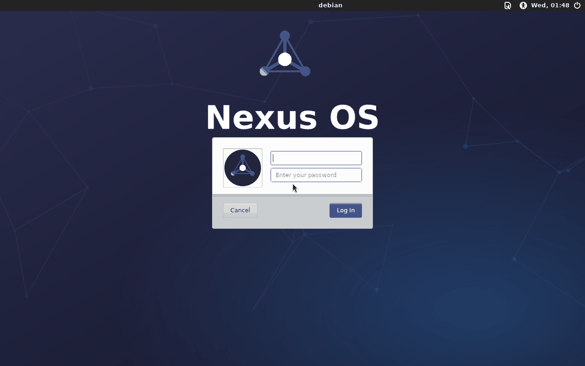

# Identidade visual do Nexus OS (F3.17)

Nome, marca, papel de parede, tela de login e tema do Nexus OS, com a origem e a licença de cada arquivo. A base continua sendo o Debian 13: o `/etc/os-release` não muda e o sistema se apresenta como Debian nas ferramentas que leem esse arquivo. A identidade do Nexus OS é visual (login, sessão e barra); nenhuma marca ou logotipo do Debian, do XFCE ou de terceiros foi usada como identidade do projeto. Medições de 27/10/2026, na VM de build do Hyper-V, **com KVM**.

## Arquivos criados para o projeto

Tudo foi desenhado do zero, com formas geométricas simples (três nós ligados a um nó central, o "nexus") e a paleta `#23253e`, `#8d2c79` e `#2b66a8` (tons mais claros, `#c0489f` e `#3f8fe0`, sobre fundo escuro). Nenhuma foto, imagem ou fonte de terceiros foi copiada. A licença é a do repositório, GPL-3.0-or-later ([LICENSE](../LICENSE)). Os caminhos da ISO são relativos à raiz do sistema.

| Arquivo no repo | Arquivo na ISO | Origem | Licença | Onde é usado |
| --- | --- | --- | --- | --- |
| `live-build/config/includes.chroot/usr/share/icons/hicolor/scalable/apps/nexus-os.svg` | `/usr/share/icons/hicolor/scalable/apps/nexus-os.svg` | criado para o projeto | GPL-3.0-or-later | ícone `nexus-os`: botão do menu da barra e imagem do usuário na tela de login |
| `live-build/config/includes.chroot/usr/share/pixmaps/nexus-os-logo.svg` | `/usr/share/pixmaps/nexus-os-logo.svg` | criado para o projeto | GPL-3.0-or-later | logotipo com o nome "Nexus OS", para documentos e telas |
| `live-build/config/includes.chroot/usr/share/backgrounds/nexus-os/papel-de-parede.svg` | `/usr/share/backgrounds/nexus-os/papel-de-parede.svg` | criado para o projeto (`scripts/gerar-identidade.py`) | GPL-3.0-or-later | fonte vetorial do papel de parede |
| `live-build/config/includes.chroot/usr/share/backgrounds/nexus-os/papel-de-parede.png` | `/usr/share/backgrounds/nexus-os/papel-de-parede.png` | criado para o projeto (1920x1080, convertido do SVG) | GPL-3.0-or-later | papel de parede padrão da sessão do `user` |
| `live-build/config/includes.chroot/usr/share/backgrounds/nexus-os/tela-de-login.svg` | `/usr/share/backgrounds/nexus-os/tela-de-login.svg` | criado para o projeto (`scripts/gerar-identidade.py`) | GPL-3.0-or-later | fonte vetorial do fundo do login |
| `live-build/config/includes.chroot/usr/share/backgrounds/nexus-os/tela-de-login.png` | `/usr/share/backgrounds/nexus-os/tela-de-login.png` | criado para o projeto (1920x1080, convertido do SVG) | GPL-3.0-or-later | fundo da tela de login, com a marca e o nome "Nexus OS" |
| `live-build/config/includes.chroot/etc/lightdm/lightdm-gtk-greeter.conf` | `/etc/lightdm/lightdm-gtk-greeter.conf` | criado para o projeto (substitui o arquivo de comentários do pacote) | GPL-3.0-or-later | fundo, tema Greybird e imagem do usuário no login |
| `live-build/config/includes.chroot/etc/xdg/xfce4/xfconf/xfce-perchannel-xml/xfce4-desktop.xml` | `/etc/xdg/xfce4/xfconf/xfce-perchannel-xml/xfce4-desktop.xml` | criado para o projeto | GPL-3.0-or-later | papel de parede padrão do XFCE (monitor `Virtual-1`, `monitor0` e `monitor1`) |
| `live-build/config/includes.chroot/etc/xdg/xfce4/xfconf/xfce-perchannel-xml/xfwm4.xml` | `/etc/xdg/xfce4/xfconf/xfce-perchannel-xml/xfwm4.xml` | criado para o projeto | GPL-3.0-or-later | tema Greybird das janelas |
| `scripts/gerar-identidade.py` | não vai para a ISO | criado para o projeto | GPL-3.0-or-later | gera os quatro SVG e os dois PNG (veja "Como regenerar") |
| `docs/img/login.png` | não vai para a ISO | captura de tela da ISO (QEMU, `screendump`) | GPL-3.0-or-later (os elementos de pacotes na imagem mantêm a licença do pacote) | tela de login da ISO |
| `docs/img/sessao.png` | não vai para a ISO | captura de tela da ISO (QEMU, `screendump`) | GPL-3.0-or-later (os elementos de pacotes na imagem mantêm a licença do pacote) | sessão do `user` com a barra, o papel de parede e os atalhos |

Linhas acrescentadas a arquivos que já existiam (mesma licença do repositório):

- `live-build/config/hooks/live/0500-nexus-servicos.hook.chroot`: título "Nexus OS" e ícone `nexus-os` no botão do menu da barra (`/etc/xdg/xfce4/panel/default.xml`), tema Greybird em `xsettings.xml`, cache de ícones e o papel de parede como alternativa `desktop-background` do Debian.
- `live-build/config/includes.chroot/etc/live/config.conf.d/nexus.conf`: `LIVE_USER_FULLNAME="Nexus OS"`, o nome completo do usuário `user` mostrado na barra (o padrão do live-config é "Debian Live user").
- `live-build/config/package-lists/nexus-desktop.list.chroot`: `greybird-gtk-theme`.

## Arquivos de pacotes do Debian

O que vem de pacote do Debian 13 `main` mantém a licença do pacote (lida em `/usr/share/doc/<pacote>/copyright` na ISO) e não é identidade do Nexus OS.

| Pacote | Versão | Licença | Onde é usado |
| --- | --- | --- | --- |
| `greybird-gtk-theme` | 3.23.3-1 | GPL-2+ ou CC-BY-SA-3.0+ (à escolha) | tema GTK e das janelas (acrescentado pela F3.17) |
| `tango-icon-theme` | 0.9.0-1 | CC0-1.0 (um arquivo, `application-pdf.png`, em LGPL-2.1) | ícones padrão do desktop (já instalado, mantido) |
| `fonts-dejavu-core` | 2.37-8 | Bitstream Vera (as mudanças do DejaVu são de domínio público) | fonte do texto "Nexus OS" nas imagens (a conversão para PNG usa a fonte instalada na máquina de build) |
| `desktop-base` | 13.0.4 | veja `/usr/share/doc/desktop-base/copyright` | dependência do desktop: traz papéis de parede e o logotipo do Debian, que **não** são usados como identidade do Nexus OS |
| `lightdm-gtk-greeter` | 2.0.9-1 | veja `/usr/share/doc/lightdm-gtk-greeter/copyright` | a tela de login em si |
| `xfce4-panel`, `xfdesktop4`, `xfwm4` | 4.20.4-1, 4.20.1-1, 4.20.0-1 | veja `/usr/share/doc/<pacote>/copyright` | barra, área de trabalho e janelas |

O ícone de barra (`nexus-os`) e o tema Greybird foram a escolha mínima: o tema de ícones Tango já instalado foi mantido. Nenhum tema de ícones extra entrou, porque os candidatos do Debian 13 (`elementary-xfce-icon-theme`, 68 MB instalados, e `papirus-icon-theme`, 187 MB) passariam do limite de 40 MB de aumento da ISO.

## Tamanho

| Item | Valor |
| --- | --- |
| ISO sem a identidade (parte 9) | 1260126208 bytes |
| ISO com a identidade | 1268842496 bytes |
| Diferença | +8716288 bytes (8,3 MiB), dentro do limite de 40 MB |
| Origem da diferença | `greybird-gtk-theme` (5415 KB instalados, `apt-cache show`) e as imagens do Nexus OS |

## Como a identidade é aplicada

- **Login:** `/etc/lightdm/lightdm-gtk-greeter.conf` aponta `background` para `tela-de-login.png`, `theme-name` para Greybird e `default-user-image` para o ícone da marca. O nome "Nexus OS" está na própria imagem de fundo. Com o login automático (padrão da ISO) a tela de login não aparece; para vê-la, inicie com o parâmetro de boot `live-config.noautologin`.
- **Sessão:** o `xfce4-desktop.xml` do `/etc/xdg` é o padrão do XFCE para qualquer usuário novo, inclusive o `user` que o live-config cria no boot; o `xsettings.xml` e o painel são ajustados no hook; o `xfwm4.xml` define o tema das janelas. O live-config só cria o usuário a partir do `/etc/skel` e não toca nesses arquivos de `/etc/xdg`: o smoke `desktop` confirma em boot limpo, como o `user` recém-criado, que o papel de parede, o tema Greybird, o título do menu e o nome completo são os do Nexus OS.
- **Papel de parede em outros monitores:** o xfdesktop guarda uma configuração por monitor. O padrão cobre o monitor `Virtual-1` (o vídeo das VMs do QEMU) e os blocos `monitor0` e `monitor1`; o hook também registra o papel de parede como alternativa `desktop-background` do Debian, o que cobre o caminho padrão `/usr/share/images/desktop-base/default`.
- **Debian:** `/etc/os-release` não tem arquivo em `includes.chroot` (o `tests/identidade.sh` confere). O que o sistema mostra como "Debian" fora da barra e do login (por exemplo `/etc/os-release`, `hostname` e a barra do greeter) continua sendo o do pacote.

## Como regenerar as imagens

O `scripts/gerar-identidade.py` escreve os quatro SVG e converte os dois fundos para PNG 1920x1080. Precisa de `python3`, `rsvg-convert` (pacote `librsvg2-bin`) e da fonte do pacote `fonts-dejavu-core`. Na VM de build, na raiz do repositório:

```bash
sudo apt-get install -y librsvg2-bin
scripts/gerar-identidade.py
```

A saída é determinística (a rede de pontos do fundo usa semente fixa). Depois de gerar, rode `tests/identidade.sh` e refaça a ISO.

## Capturas de tela

As capturas usam o comando `screendump` do monitor do QEMU com `-vga std` (1280x800), convertido para PNG de 128 cores com o `python3-pil` (pacote `python3-pil`), com até 300 KB cada.

- `docs/img/sessao.png`: a ISO iniciada normalmente; a captura foi feita 70 s depois do boot, com a sessão do `user` já aberta.
- `docs/img/login.png`: a tela de login só aparece sem o login automático. A captura usou boot direto do kernel e do initrd da ISO com o parâmetro `live-config.noautologin`, só para essa captura; a ISO entregue não muda. O relógio e o nome de máquina `debian` que aparecem na barra do login são os do próprio boot.




## Problemas conhecidos

- A barra do login mostra o nome de máquina `debian` e o relógio, porque o `lightdm-gtk-greeter` os mostra sempre; o nome de máquina não foi alterado.
- O `desktop-base` continua instalado (dependência do desktop) e traz o logotipo e os papéis de parede do Debian em `/usr/share`; nenhum é usado pelo Nexus OS.
- Fora do QEMU (`Virtual-1`), o papel de parede padrão não foi conferido em outro vídeo: no Hyper-V e no VirtualBox o monitor pode ter outro nome; o roteiro humano da parte H do [checklist](checklist-teste-documentacao.md) confere.
- O texto "Nexus OS" nas imagens usa a fonte DejaVu Sans Bold instalada na máquina que roda o gerador. Em outra máquina o PNG pode sair com outra fonte; o texto "Nexus OS" do `nexus-os-logo.svg` e dos SVG depende da fonte instalada em quem abrir o arquivo.
- Reprodução por segunda pessoa e a conferência em Hyper-V e VirtualBox continuam pendentes.
