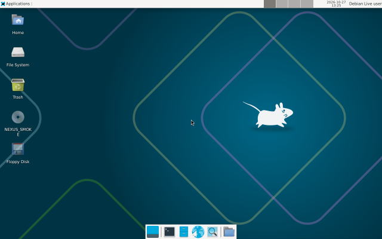
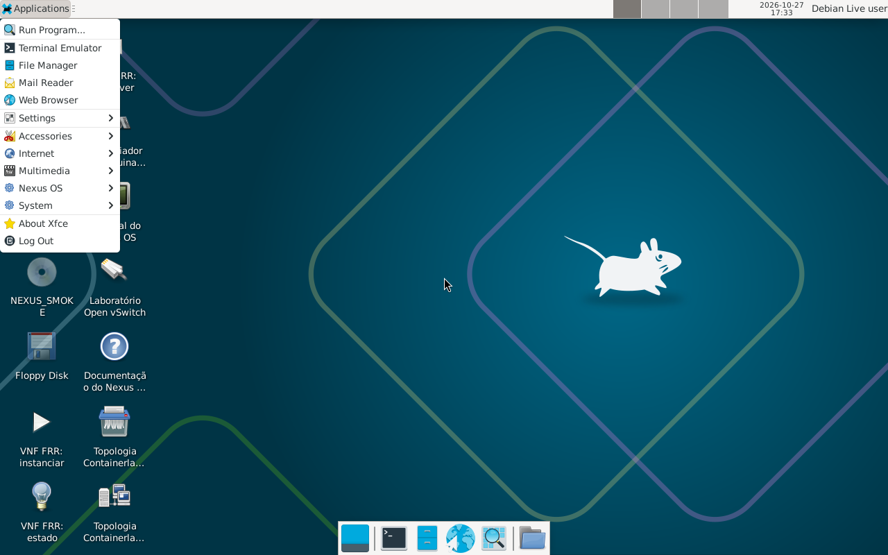

# Ambiente gráfico: especificação e escolha do desktop (F3.14)

Este documento define o que o Nexus OS entende por interface gráfica, compara por medição os candidatos do Debian 13 (trixie) `main` e registra o desktop escolhido. As seções até "Impacto nos requisitos" são a especificação e a escolha (F3.14), com números de 27/10/2026 medidos **com KVM** na VM de build do Hyper-V (veja [hyperv.md](hyperv.md)). A instalação do desktop na ISO (F3.15) e dos atalhos (F3.16) está em "Como ficou na ISO", "Atalhos" e "Medições da ISO".

## Definição

"Interface gráfica de um sistema operacional atual" significa, no Nexus OS, uma sessão de desktop completa com pacotes do Debian 13 `main`, sem painel web próprio. O critério de aceite da F3.15 é a lista abaixo; cada item foi verificado nos finalistas por comando ou captura de tela.

1. Gerenciador de login com login automático do usuário `user`.
2. Sessão gráfica padrão ativa (`Type=x11` ou `wayland`, `State=active` no `loginctl`).
3. Barra e menu de aplicativos.
4. Gerenciador de janelas.
5. Gerenciador de arquivos gráfico.
6. Terminal gráfico.
7. Navegador: `firefox-esr` 153.5.1esr-1~deb13u1 (`apt-cache policy firefox-esr`).
8. Configuração de rede gráfica (NetworkManager com applet) e de vídeo.
9. Sem internet no boot e sem erro de login.

## Candidatos

Passo A, sem ISO, na VM de build (Debian 13, sem nenhum desktop instalado). Para cada candidato: metapacote do desktop, o gerenciador de login padrão dele e `firefox-esr`. Versão: `apt-cache policy <metapacote>`, linha `Candidato`. Pacotes: `apt-get install -s --no-install-recommends <metapacote> <login> firefox-esr`, linhas `Inst`. Tamanhos: `apt-get install --assume-no --no-install-recommends ...`, linhas `Need to get` (a baixar) e `After this operation` (instalado), em MB do apt.

| Candidato | Metapacote | Versão | Pacotes | A baixar (MB) | Instalado (MB) | Login |
| --- | --- | --- | --- | --- | --- | --- |
| XFCE | `xfce4` | `4.20.1` | 70 | 102 | 401 | `lightdm` |
| LXQt | `lxqt` | `33.2` | 160 | 153 | 508 | `lightdm` |
| MATE | `mate-desktop-environment` | `1.26.0+2` | 184 | 165 | 724 | `lightdm` |
| GNOME | `gnome-core` | `1:48+2` | 559 | 417 | 1645 | `gdm3` |
| KDE Plasma | `kde-plasma-desktop` | `5:162` | 499 | 292 | 1068 | `sddm` |

Versões dos gerenciadores de login: `lightdm` 1.32.0-6+b2, `gdm3` 48.0-2, `sddm` 0.21.0+git20250502.4fe234b-2.

Os três de menor tamanho instalado (XFCE, LXQt e MATE) viram finalistas. GNOME (1645 MB) e KDE Plasma (1068 MB) ficam só com estes números: instalam de 2,7 a 4,1 vezes mais que o XFCE e não foram medidos em ISO.

Conferência de sanidade: com `--no-install-recommends` o XFCE, o LXQt e o MATE ficam sem servidor X (`xorg`) e sem applet de rede. Repetido o passo A com `xorg` e `network-manager-gnome` somados, o instalado vira XFCE 659 MB (225 pacotes), LXQt 614 MB (218), MATE 793 MB (242), KDE Plasma 1112 MB (532) e GNOME 1703 MB (602): os três menores continuam sendo os mesmos.

## Medição

Passo B: uma ISO de teste por finalista, fora do repositório, em um clone temporário da VM de build, com o núcleo atual do repositório mais a lista de pacotes do desktop e nada mais (sem atalhos nem identidade visual). Lista de cada finalista, todos com `lightdm`, `lightdm-gtk-greeter`, `xorg`, `firefox-esr` e `network-manager`:

- XFCE: `xfce4`, `xfce4-terminal`, `network-manager-gnome`
- LXQt: `lxqt`, `nm-tray`
- MATE: `mate-desktop-environment`, `network-manager-gnome`

Cada ISO foi iniciada duas vezes no QEMU com KVM, 4096 MiB, 2 vCPU, `-vga std`, sem rede (`-nic none`) e sem janela (`-display none`). Dentro da ISO um teste espera a sessão do `user` (`loginctl`), registra o `uptime` do guest nesse instante, espera 30 s e lê `free -m` (coluna `used`) 3 vezes com 5 s de intervalo. A coluna RAM é a média das 3 leituras. "Até a sessão" é o `uptime` do guest quando a sessão ficou `active`, em segundos.

| Finalista | Leitura | ISO (bytes) | Build (s) | RAM em repouso (MiB) | Até a sessão (s) | Modo |
| --- | --- | --- | --- | --- | --- | --- |
| XFCE | 1 | 1252147200 | 2240 | 852.7 | 28.4 | com KVM |
| XFCE | 2 | 1252147200 | 2240 | 850.7 | 25.0 | com KVM |
| LXQt | 1 | 1602748416 | 2399 | 868.3 | 26.0 | com KVM |
| LXQt | 2 | 1602748416 | 2399 | 869.7 | 26.4 | com KVM |
| MATE | 1 | 1481506816 | 655 | 889.7 | 29.0 | com KVM |
| MATE | 2 | 1481506816 | 655 | 901.7 | 26.3 | com KVM |

- A ISO do núcleo sem desktop (RC1, [rc1.md](rc1.md)) tem 921698304 bytes.
- Tamanho de `/` em uso: a raiz da live é um overlay sobre tmpfs (26 a 28 MiB usados em todos). O conteúdo do sistema está no `squashfs`, medido com `df -m /run/live/rootfs/filesystem.squashfs`: XFCE 1112 MiB, LXQt 1446 MiB, MATE 1330 MiB.
- O tempo de build do XFCE e do LXQt inclui o download frio dos pacotes (a VM baixa tudo da internet); o MATE foi construído depois, com o cache de pacotes do live-build já quente. Não compare os tempos de build entre si.
- Uma rodada anterior das mesmas ISOs, antes de acrescentar a medição do `squashfs`, deu a mesma ordem: RAM XFCE 857.3 e 846.7, LXQt 867.7 e 864.0, MATE 902.0 e 897.7 MiB.
- Checklist da definição (itens 1 a 9) nos três finalistas: todos cumprem. `lightdm` ativo, sessão do `user` em `seat0` com `Type=x11` e `State=active`, nenhuma rota padrão (`ip route`), e:

| Item | XFCE | LXQt | MATE |
| --- | --- | --- | --- |
| Barra e menu | `xfce4-panel` | `lxqt-panel` | `mate-panel` |
| Janelas | `xfwm4` | `xfwm4` | `marco` |
| Arquivos | `thunar` | `pcmanfm-qt` | `caja` |
| Terminal | `xfce4-terminal` | `qterminal` | `mate-terminal` |
| Rede | `nm-applet` | `nm-tray` | `nm-applet` |
| Vídeo | `xfce4-display-settings` | `lxqt-config-monitor` | `mate-display-properties` |

Captura de tela do XFCE (comando `screendump` do monitor do QEMU, convertida para PNG): 

## Escolha

Desktop escolhido: **XFCE**

Regra da decisão: entre os finalistas que cumprem os 9 itens, vale a menor RAM em repouso; diferença menor que 5% desempata pelo menor tamanho de ISO. Média das duas leituras: XFCE 851.7 MiB, LXQt 869.0 MiB, MATE 895.7 MiB. O XFCE tem a menor RAM e a diferença para o LXQt é de 2,0%, então a regra de empate também decide pelo XFCE: a ISO dele (1252147200 bytes) é a menor, 350601216 bytes abaixo da do LXQt e 229359616 abaixo da do MATE. Também tem o menor tamanho instalado no passo A e o menor `squashfs`.

Lista de pacotes validada para a F3.15 (versões conferidas na ISO de teste, `chroot.packages.install`):

| Pacote | Versão |
| --- | --- |
| `xfce4` | 4.20.1 |
| `xfce4-terminal` | 1.1.4-1 |
| `xfce4-panel` | 4.20.4-1 |
| `xfwm4` | 4.20.0-1 |
| `xfce4-settings` | 4.20.1-1 |
| `thunar` | 4.20.2-1+deb13u1 |
| `lightdm` | 1.32.0-6+b2 |
| `lightdm-gtk-greeter` | 2.0.9-1 |
| `xorg` | 1:7.7+24+deb13u1 |
| `firefox-esr` | 153.5.1esr-1~deb13u1 |
| `network-manager` | 1.52.1-1 |
| `network-manager-gnome` | 1.36.0-3+b1 |

Login automático: o `live-config` 11.0.5 da ISO traz os scripts `0080-gdm3`, `0085-sddm` e `0100-lightdm`. O `0100-lightdm` troca, em `/etc/lightdm/lightdm.conf`, as linhas comentadas `autologin-user=` e `autologin-user-timeout=` por `autologin-user=user` e `autologin-user-timeout=0`; os parâmetros de boot `live-config.noautologin` e `live-config.nox11autologin` o desligam. Nenhuma configuração própria foi necessária: nas medições a sessão do `user` subiu sozinha.

## Sessão sem janela

O `tests/iso-smoke.sh` inicia o QEMU sem interface (`-display none`) e sem rede, com a serial em arquivo. O comando validado nas medições, com a ISO e o CD de comandos `NEXUS_SMOKE`:

```bash
qemu-system-x86_64 -enable-kvm -cpu host -m 4096 -smp 2 -vga std -usb -device usb-tablet \
    -drive file=<iso>,media=cdrom,readonly=on,index=2 \
    -drive file=<smoke.iso>,media=cdrom,readonly=on,index=3 \
    -boot d -nic none -display none -serial file:<serial.log> \
    -chardev pipe,id=mon,path=<fifo> -mon chardev=mon,mode=readline
```

`-vga std` e `-device usb-tablet` entraram nas medições e na captura da F3.14. Desde a F3.15 o `tests/iso-smoke.sh` passa `-vga std` explícito e não passa o tablet (o smoke não usa o ponteiro). Veja "Como ficou na ISO".

Dentro do guest, sem tela, a sessão é consultada por `loginctl`:

```bash
loginctl list-sessions --no-legend
loginctl show-session <id> -p Name -p Type -p State --value
```

A sessão do `user` está pronta quando `Name=user`, `Type=x11` e `State=active`. A captura de tela vem do monitor: `screendump arquivo.ppm` (PPM, convertido para PNG com Python).

RAM mínima medida com o XFCE (com KVM, 2 vCPU, uma execução por valor): o smoke `containers` (`NEXUS_SMOKE_MEM=<MiB> tests/iso-smoke.sh <iso> containers`) e a sessão ativa.

| RAM do guest (MiB) | Smoke `containers` | Sessão do `user` ativa |
| --- | --- | --- |
| 4096 | OK em 45 s, pico 989 MiB | sim (medições acima) |
| 3072 | OK em 42 s, pico 909 MiB | não medido |
| 2048 | OK em 39 s, pico 786 MiB | sim, 25.8 s, 753 MiB |
| 1536 | OK em 39 s, pico 786 MiB | sim, 27.1 s, 746 MiB |
| 1024 | OK em 45 s, pico 720 MiB | sim, 29.3 s, 741 MiB |
| 768 | FALHA: `NEXUS-SMOKE-DONE não apareceu em 300 s` | não medido |

O mínimo medido com o desktop é **1024 MiB**; em 768 MiB o `containers` falha (como na ISO do núcleo, veja [requisitos.md](requisitos.md)). O `tests/iso.sh` com a ISO do XFCE passou com os 1024 MiB que ele usa: `OK: ISO chegou ao login` em 33 s, com KVM.

Recomendação: manter `NEXUS_SMOKE_MEM=4096` (padrão). Para uso interativo, 2048 MiB como valor provisório; a RAM recomendada definitiva é a da F3.18, medida na ISO da RC2 com o `all` e o desktop ativo: 2048 MiB ([requisitos.md](requisitos.md), seção "Com ambiente gráfico"; os picos da F3.15 e da F3.16 estão em "Medições da ISO"). O `tests/iso.sh` ganhou a variável `NEXUS_ISO_MEM` na F3.15 (padrão 2048 MiB).

VMs de build:

- Hyper-V: a ISO de teste tem boot BIOS (isolinux) e UEFI (`/boot/grub/efi.img`), conferido com `xorriso -indev <iso> -report_el_torito plain`. Isso permite uma VM de Geração 2; o boot nela e o Secure Boot não foram validados.
- VirtualBox: sem KVM (em CPU AMD o KVM aninhado derruba a VM, veja [integracao-iso.md](integracao-iso.md)); o desktop não foi validado lá.

## Impacto nos requisitos

| Item | Núcleo (RC1) | Com XFCE | Fonte |
| --- | --- | --- | --- |
| ISO (bytes) | 921698304 | 1252147200 | tamanho do arquivo; +330448896 bytes (mídia de pelo menos 1195 MiB) |
| RAM mínima do smoke `containers` (MiB) | 896 (768 falha) | 1024 (768 falha) | `NEXUS_SMOKE_MEM`; com o XFCE o 896 não foi testado |
| RAM em repouso (MiB) | 796 | 852 (sessão ativa, média) | `free -m`, `used`; pontos de medição diferentes, veja abaixo |
| Disco do root em memória (MiB) | 24 | 26 a 28 | `df -m /` (overlay sobre tmpfs) |

A ISO cresce 36%. O "repouso" do núcleo foi lido pelo `nexus-smoke` antes do primeiro teste, sem sessão gráfica; o do XFCE é a média de 3 leituras 30 s depois de a sessão ficar ativa. No `containers` com 4096 MiB o runner leu 989 MiB no início, com o desktop ainda subindo. A F3.18 refaz `docs/requisitos.md` com o `all` e o desktop ativo.

## Como ficou na ISO

F3.15 e F3.16, medidos em 27/10/2026 na VM de build do Hyper-V, **com KVM** (e uma vez **sem KVM**, indicado onde for o caso).

- Pacotes (na F3.15; a lista atual, com os programas da rodada 3, está em "Programas incluídos"): `live-build/config/package-lists/nexus-desktop.list.chroot` (`xfce4`, `xfce4-terminal`, `network-manager`, `network-manager-gnome`, `lightdm`, `lightdm-gtk-greeter`, `xorg`, `firefox-esr`, `virt-manager`, `desktop-file-utils`, `x11-utils`, `libgtk-3-bin`, `libglib2.0-bin`). Os quatro últimos servem ao smoke e aos atalhos: `desktop-file-validate`, `xwininfo`, `gtk-launch` e `gio`.
- Login automático e sessão padrão: nenhum arquivo próprio. O `0100-lightdm` do `live-config` já grava `autologin-user=user` e o `lightdm` do pacote é o `display-manager`; a sessão padrão é a do XFCE.
- `nexus-smoke.service` não ganhou `After=lightdm.service`, porque o teste `desktop` espera por laço (limite de 120 s) o `lightdm`, a sessão e os processos do desktop, sem depender da ordem das unidades. Uma primeira versão com o `After=` também passou; foi retirado para o laço de espera ser exercitado de verdade.
- Menu: categoria "Nexus OS" por `etc/xdg/menus/applications-merged/nexus-os.menu` e `usr/share/desktop-directories/nexus-os.directory`. A categoria dos atalhos é `X-Nexus-OS` (categoria própria precisa do prefixo `X-`).
- Área de trabalho: as cópias dos atalhos ficam em `/etc/skel/Desktop/` (o `live-config` cria o `user` a partir do `/etc/skel`). O xfdesktop só confia em atalho com o bit de execução e o checksum em `metadata::xfce-exe-checksum` ([fórum do Xfce](https://forum.xfce.org/viewtopic.php?pid=70670)). O hook dá `chmod 0755` nas cópias e o autostart `etc/xdg/autostart/nexus-atalhos-confiar.desktop` roda `/usr/local/bin/nexus-atalhos-confiar`, que grava o checksum com `gio set`. O smoke confere o bit e o checksum de cada cópia, e a captura abaixo mostra os ícones sem aviso de atalho não confiável.
- `qemu:///system`: `etc/libvirt/libvirt.conf` com `uri_default = "qemu:///system"` e o atalho do `virt-manager` com `--connect qemu:///system`; o `user` já está no grupo `libvirt` (veja [integracao-iso.md](integracao-iso.md)).
- `tests/iso-smoke.sh` passou a iniciar o QEMU com `-vga std` explícito e ganhou `NEXUS_SMOKE_KVM=0` (força a emulação). Não houve RED para o `-vga std`: o QEMU já usa `std` por padrão, e a ISO com desktop chegou à sessão sem o parâmetro (smoke `desktop` OK antes da mudança). O RED de `NEXUS_SMOKE_KVM=0` foi real: o script antigo ignorou a variável e imprimiu `com KVM`; o novo imprime `sem KVM (emulação por software)`.
- `tests/iso.sh` ganhou `NEXUS_ISO_MEM` (padrão 2048 MiB, a RAM provisória recomendada para uso interativo) e chega ao `login:` da serial em 33 s com KVM.
- Captura da sessão com o menu aberto (comando `screendump` do monitor do QEMU, convertida para PNG): 

## Atalhos

Dez arquivos `nexus-*.desktop`, em `/usr/share/applications/` (menu "Nexus OS") e em `~/Desktop/` do `user`. Fonte: `live-build/config/includes.chroot/usr/share/applications/` e `live-build/config/includes.chroot/etc/skel/Desktop/`. Os atalhos de terminal usam `xfce4-terminal --disable-server` (sem o servidor, a janela não abre dentro de uma instância já existente, que perderia o ambiente do chamador) e o wrapper `/usr/local/bin/nexus-atalho <nome> <comando>`: roda o comando, mostra a saída e o código, grava o código em `$XDG_RUNTIME_DIR/nexus-atalho-<nome>.status` e espera Enter, exceto com `NEXUS_ATALHO_TESTE=1`.

| Atalho | Comando | Onde aparece |
| --- | --- | --- |
| Terminal do Nexus OS | `xfce4-terminal` | menu e área de trabalho |
| Gerenciador de máquinas virtuais | `virt-manager --connect qemu:///system` | menu e área de trabalho |
| Laboratório Open vSwitch | `sudo nexus-sdn up` (para remover: `sudo nexus-sdn down` no terminal) | menu e área de trabalho |
| VNF FRR: instanciar | `sudo nexus-vnf up` | menu e área de trabalho |
| VNF FRR: estado | `sudo nexus-vnf status` | menu e área de trabalho |
| VNF FRR: remover | `sudo nexus-vnf down` | menu e área de trabalho |
| Topologia Containerlab: criar | `sudo containerlab deploy -t /usr/share/nexus-os/labs/containerlab/frr-duo.clab.yml` | menu e área de trabalho |
| Topologia Containerlab: remover | `sudo containerlab destroy -t /usr/share/nexus-os/labs/containerlab/frr-duo.clab.yml --cleanup` | menu e área de trabalho |
| Documentação do Nexus OS | `firefox-esr /usr/share/nexus-os/docs-html/index.html` (a documentação em HTML, sem internet) | menu e área de trabalho |
| Configurações | `xfce4-settings-manager` (rede, aparência, teclado, vídeo) | menu, área de trabalho e barra |

Testes:

- `tests/atalhos.sh` (estático, roda no Git Bash e na VM): os 10 arquivos existem no menu e na área de trabalho com conteúdo igual, passam no `desktop-file-validate` (se instalado; senão o teste termina em `AVISO:`), têm as chaves `Type`, `Name`, `Exec`, `Icon` e `Categories`, `Comment` em português e `Exec` apontando para comando versionado ou do pacote; confere também `libvirt.conf`, o menu, o `mimeapps.list`, o gerador `nexus-docs-html`, que os pacotes dos programas estão na lista (e que Thunderbird e GParted não estão) e que nenhum arquivo está ignorado pelo `.gitignore`.
- Smoke `desktop` (`tests/desktop.sh`, dentro da ISO): `lightdm` ativo; sessão do `user` `active` e `x11` com `xfce4-session`, `xfce4-panel` e `xfwm4` no ar (espera por laço, limite de 120 s); sem rota padrão e sem erro do `lightdm` no journal (`journalctl -b -u lightdm -p err`); os 10 atalhos válidos no `desktop-file-validate` e com o comando existente; cópias na área de trabalho executáveis e com o checksum do xfdesktop. Cada atalho é lançado como o `user` por `gtk-launch <id>` (funcionou, sem precisar do `Exec` à mão), com `DISPLAY`, `XAUTHORITY`, `XDG_RUNTIME_DIR` e `DBUS_SESSION_BUS_ADDRESS` lidos do processo `xfce4-session`. Terminal, documentação (Firefox), configurações e `virt-manager` são conferidos por janela no `xwininfo -root -tree` (o padrão não pode casar antes de abrir) e por processo vivo depois de 3 s (15 s no `virt-manager`); os seis atalhos de terminal, pelo arquivo de status com código 0. A espera por janela é de 150 s, por causa do Firefox sem KVM. O teste confere ainda a barra (um painel só, embaixo, com `tasklist` e sem `pager`; uma área de trabalho), o idioma, o fuso, o teclado, o nome da máquina, a tela sem bloqueio, o programa padrão de cada tipo de arquivo, a presença dos programas, o `docs-html`, o grupo `wireshark` e o `dumpcap`. A limpeza (`nexus-sdn down`, `nexus-vnf down`, `containerlab destroy`, `thunar -q`) roda no `trap`, e o teste confere que nenhum contêiner nem a bridge `br-nexus` sobrou.

## Barra, tema de ícones e idioma

Rodada 3 da RC2 (F3.17), feita depois de a ISO ser testada no Hyper-V Geração 1.

- **Barra única embaixo, como a do Windows** (`etc/xdg/xfce4/panel/default.xml`, 46 px, de ponta a ponta): botão "Nexus OS" (menu), lançadores (Terminal, Arquivos, Firefox, Gerenciador de máquinas virtuais, Configurações), lista das janelas abertas (`tasklist`, ocupa o espaço livre), bandeja (rede), som, relógio, usuário e "mostrar a área de trabalho". Não há painel em cima, e o seletor de áreas de trabalho (`pager`) saiu: o `xfwm4.xml` tem `workspace_count` 1.
- **Ícones padrão no tema do Nexus OS:** o tema `Nexus` (`usr/share/icons/Nexus`, herda do `Papirus-Dark` e do `hicolor`) redesenha pasta pessoal, lixeira (vazia e cheia), disquete, mídia óptica, unidades, computador e gerenciador de arquivos no estilo dos ícones dos atalhos. É o `IconThemeName` do `user` e do login. O disquete que a máquina virtual do Hyper-V mostra é hardware da VM, não do Nexus OS; ele só ganhou o ícone do tema.
- **Rótulos dos ícones da área de trabalho:** sem caixa, branco com sombra (`XfdesktopIconView` no `gtk.css` do `Nexus-Dark`).
- **Fundos sem faixas:** os gradientes dos fundos recebem ruído fino (`feTurbulence`), que esconde as faixas que 8 bits por canal deixam em gradiente suave.
- **Menu de boot (isolinux na BIOS e GRUB na UEFI):** título "Nexus OS", entradas "Iniciar o Nexus OS" e "Nexus OS (modo de compatibilidade)", fundo e cores da paleta, sem o capacete do live-build e sem o texto "Debian GNU/Linux", e **contagem de 5 s** (o Nexus OS inicia sozinho; Enter adianta). Arquivos em `live-build/config/bootloaders/`.
- **Idioma e região:** português do Brasil (`LIVE_LOCALES="pt_BR.UTF-8"`), fuso `America/Sao_Paulo`, teclado ABNT2 (`LIVE_KEYBOARD_MODEL="abnt2"`, layout `br`, e o `00-nexus-teclado.conf` para o X) e nome da máquina `nexus-os` (no lugar de `debian`, issue 57), tudo em `etc/live/config.conf.d/nexus.conf`. O `nexus-smoke` roda com `LC_ALL=C.UTF-8`: os testes comparam saídas em inglês.
- **Tela sem bloqueio:** `xfce4-screensaver` e `light-locker` não estão instalados e o `10-nexus-sem-bloqueio.conf` zera o `BlankTime` do Xorg: a tela não apaga nem pede senha.
- **Programa padrão por tipo de arquivo:** `etc/xdg/mimeapps.list`. `.md`, `.txt` e outros textos abrem no Mousepad, PDF no Evince, imagens no Ristretto, HTML e links no Firefox, `.zip` e `.tar` no File Roller, vídeo e áudio no VLC, documentos do Office no LibreOffice.
- **Print Screen:** o `xfce4-screenshooter` está instalado e a tecla Print já vem ligada a ele pelo `xfce4-settings`.

## Programas incluídos

Lista da `nexus-desktop.list.chroot`. Os tamanhos são o download extra de cada grupo sobre a ISO da RC2 anterior, medido com `apt-get --print-uris` contra o `dpkg status` da própria ISO; o aumento real da ISO está em "Medições da ISO".

| Grupo | Programas (pacotes) | Download estimado |
| --- | --- | --- |
| Texto, PDF, imagens e arquivos | Mousepad (`mousepad`, editor e leitor de `.md`), Evince (`evince`, PDF), Ristretto (`ristretto`, imagens), File Roller (`file-roller`, zip e tar), Calculadora (`galculator`), Captura de tela (`xfce4-screenshooter`), `python3-markdown` | 27 MB |
| Rede e laboratório | `tcpdump`, `iperf3`, `mtr-tiny`, `nmap`, `traceroute`, `dnsutils` (`dig`), `netcat-openbsd`, `curl`, `wget`, `tmux`, `htop`, `vim`, `git`, Remmina (`remmina`, acesso remoto) | 63 MB |
| Idioma | `locales`, `console-setup`, `keyboard-configuration`, `firefox-esr-l10n-pt-br`, `libreoffice-l10n-pt-br`, `libreoffice-help-pt-br` | 7 MB |
| Escritório | LibreOffice (`libreoffice-writer`, `libreoffice-calc`, `libreoffice-impress`, `libreoffice-gtk3`) | 105 MB |
| Mídia, imagem e senhas | VLC (`vlc`), GIMP (`gimp`), Inkscape (`inkscape`), KeePassXC (`keepassxc`) | 95 MB |
| Captura de pacotes | Wireshark (`wireshark`), com o `dumpcap` liberado para o grupo `wireshark` (o `user` está nele): captura sem `sudo` | 43 MB |

Ficaram de fora, por decisão do grupo: Thunderbird (81 MB) e GParted (5 MB). O Evince entrou no lugar do Atril porque o Atril puxa 59 MB de dependências e o Evince 20 MB.

**Documentação em HTML:** o hook `0500-nexus-servicos` roda `/usr/local/bin/nexus-docs-html` no build e converte `docs/*.md` (já copiados para `/usr/share/nexus-os/docs`) em HTML em `/usr/share/nexus-os/docs-html`, com a paleta da logo. O atalho "Documentação do Nexus OS" abre o `index.html` no Firefox, sem internet. Os links entre documentos viram `.html`; links para arquivos fora de `docs/` (por exemplo `../README.md`) não resolvem lá. A política do Firefox (`policies.json`) tira a página de boas-vindas e define a documentação como página inicial. Para usar o conversor na VM de desenvolvimento: `nexus-docs-html docs /tmp/docs-html` (precisa de `python3-markdown`).

**Internet:** a ISO não traz rede configurada; com a VM conectada a uma rede, o NetworkManager (ícone na barra) conecta sozinho por DHCP. No Hyper-V, a VM criada sem placa de rede não tem onde conectar: `Connect-VMNetworkAdapter -VMName <vm> -SwitchName "Default Switch"` (veja [manual.md](manual.md)). Os smokes rodam sempre sem rede (`-nic none`).

## Medições da ISO

| Item | Valor |
| --- | --- |
| ISO | `dist/nexus-os-poc-amd64.iso`, 1260126208 bytes, SHA256 `def4c0d541b1016b97d0e441a41851135ddc23edb84544931bdadcdfb0fa55c6` |
| Diferença para a ISO do núcleo (RC1, 921698304 bytes) | +338427904 bytes (+36,7%); para a ISO de teste do XFCE da F3.14 (1252147200 bytes), +7979008 (o `virt-manager` e as ferramentas) |
| Build (`sudo scripts/build-iso.sh`) | 457 s no build final e 536 s no primeiro, com o cache de pacotes quente (o download frio do XFCE levou 2240 s na F3.14) |
| `tests/iso.sh` | `OK: ISO chegou ao login` em 33 s, com KVM, 2048 MiB |
| `all` (8 testes), 4096 MiB, com KVM | `OK` em 120 s: `sdn=5s`, `virtualizacao=3s`, `libvirt=2s`, `containers=2s`, `frr=1s`, `nfv=18s`, `orquestracao=9s`, `desktop=41s`; repouso 971 MiB, pico 1007 MiB |
| `all`, 2048 MiB, com KVM | `OK` em 114 s, `desktop=40s`; repouso 756 MiB, pico 925 MiB |
| RAM em repouso, sessão ativa (`free -m`, `used`, 3 leituras 30 s depois) | 840,3 MiB com KVM e 4096 MiB (837, 842 e 842); 748 MiB sem KVM, 2048 MiB e 1 vCPU |
| Sessão do `user` ativa, com KVM | já ativa quando o teste começou, com uptime do guest de 25,0 s |
| Sessão do `user` ativa, sem KVM | já ativa quando o teste começou, com uptime de 258,8 s |
| Smoke `desktop` sem KVM (`NEXUS_SMOKE_KVM=0 NEXUS_SMOKE_SMP=1 NEXUS_SMOKE_MEM=2048`) | `OK: 2 teste(s) sem falha em 477 s`, `desktop=161s`: os 9 atalhos da época executavam sem KVM |

Rodada 3 da RC2 (ISO atual, build limpo do commit `d9c40b8`): ISO de 1773174784 bytes (+513048576 sobre a da tabela acima, por causa dos programas), build de 1164 s; `all` com 4096 MiB `OK` em 181 s (`desktop=64s`, repouso 1115 MiB, pico 1827 MiB) e com 2560 MiB `OK` em 172 s; sessão ativa em 23 s; smoke `desktop` sem KVM `OK` em 1196 s (`desktop=782s`). Os números completos e os mínimos de RAM estão em [requisitos.md](requisitos.md) e [rc2.md](rc2.md); os desta seção são da F3.15 e da F3.16.

O uptime da sessão é um limite superior: a sessão pode ter ficado ativa antes do início do teste, porque o `nexus-smoke.service` só começa depois dos serviços dos componentes. A medição de repouso e do uptime vem de um script fora do repositório (`--extra`: espera a sessão, lê `free -m` 3 vezes com 30 s de atraso).

Mutações (4 de 4, com cópia de `tests/desktop.sh` por `--extra`, sem rebuild; as estáticas com cópia de backup, restaurada por cópia):

| Mutação | Resultado |
| --- | --- |
| M1: remover o `Exec` de um atalho | `FALHA: ... sem a chave Exec`, `tests/atalhos.sh` sai com 1 |
| M2: apagar o atalho do `virt-manager` | `FALHA: atalho ausente no menu: .../nexus-virt-manager.desktop` |
| M3: esperar os processos do MATE (`mate-session mate-panel marco`) | `FALHA: processo mate-session não está rodando como user`, depois dos 120 s de espera |
| M4: limite de espera da sessão menor que o boot | Com limite de 5 s o teste ainda passa: a sessão já está ativa quando ele começa e, mesmo depois de `systemctl stop lightdm` e `start`, a sessão e os processos sobem em 2 s com KVM. Com limite de 1 s e o `lightdm` reiniciado: `FALHA: sessão gráfica de user não ficou ativa em 1 s`; o controle (reinício e limite de 120 s) passa com a sessão ativa em 2 s. O laço de espera é real, mas o valor de 5 s do enunciado não chega a falhar nesta VM |

## Problemas conhecidos

- Os números do passo A (candidatos) são relativos ao estado da VM de build (Docker, QEMU e outros já instalados) e usam `--no-install-recommends`; por isso a sanidade com `xorg` e o applet de rede está acima. A medição que decide é a do passo B, em ISO.
- Item 8 da definição: o `nm-applet` está em execução na ISO com desktop, mas o ícone não aparece na captura (sem rede). Foi verificado por processo, não por clique; o ícone com o desktop em VM com rede não foi conferido.
- Item 9: o smoke `desktop` confere que `journalctl -b -u lightdm -p err` está vazio, além da sessão `active` e do `lightdm` ativo. Os arquivos de `/var/log/lightdm` não são lidos.
- Boot em Hyper-V Geração 2, Secure Boot e VirtualBox não foram validados (veja "Sessão sem janela").
- O tempo "até a sessão" é o `uptime` do guest: não inclui firmware nem o menu do isolinux. O tempo medido no host, do início do QEMU até o marcador, ficou entre 33 s e 38 s.
- A RAM do 768 MiB foi testada em uma execução só, e o 3072 MiB e o 896 MiB não tiveram a sessão medida com o XFCE.
- `all` com o desktop foi executado na F3.15 e na F3.16 (8 testes, veja "Medições da ISO"). O 768 MiB, o 896 MiB e o 3072 MiB ainda não foram testados com os atalhos.
- O script de medição de RAM e de uptime da sessão e o de captura de tela ficaram fora do repositório (o método está em "Medições da ISO" e em "Como ficou na ISO"). O smoke `desktop` definitivo é o `tests/desktop.sh`.
- Reprodução por uma segunda pessoa e a medição nas máquinas dos demais integrantes continuam pendentes.
- O smoke `desktop` começa com a sessão já ativa (a unidade só roda depois dos serviços dos componentes), então o tempo real até a sessão não sai dele: o uptime medido (25,0 s com KVM, 258,8 s sem) é só um limite superior.
- Os atalhos de terminal funcionam no smoke com `NEXUS_ATALHO_TESTE=1`; o fluxo interativo (janela do terminal esperando Enter, clique no ícone) foi conferido só pela captura de tela dos ícones e do menu, não por clique.
- O atalho "Laboratório Open vSwitch" só cria o laboratório; a remoção é `sudo nexus-sdn down` no terminal.
- O `virt-manager` foi conferido por janela e por processo vivo depois de 15 s; não se abriu nem criou VM por ele.
- Sem KVM a sessão leva cerca de 259 s para ficar ativa (1 vCPU, 2048 MiB), então o limite de 120 s do laço de espera do `tests/desktop.sh` só serve porque o teste começa depois de a sessão estar ativa; em outra ordem de unidades o limite sem KVM seria curto.
