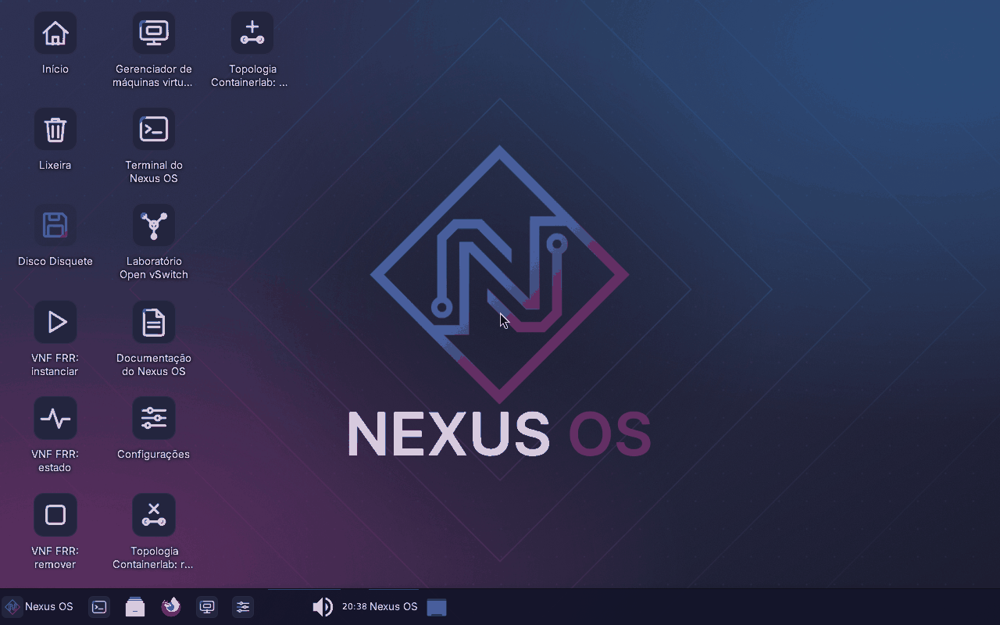

# Manual v2 do Nexus OS (RC2 final)

Este manual explica, do zero, como gerar a ISO do Nexus OS, iniciá-la e usar cada componente dela. Foi escrito para quem **nunca viu o projeto**: cada passo diz **onde fazer**, **o que fazer**, **por que fazer**, **o que deve aparecer** e **o que fazer se não aparecer**. Leia a seção do passo inteira antes de executá-lo.

Os blocos marcados `bash nexus-exec` são os que o `tests/manual.sh` executa dentro da ISO, sem rede, em ordem, e cada um limpa o que criou. Os demais blocos são exemplos que o teste não executa. Roteiro para quem vai executar o manual inteiro e registrar o resultado: [checklist-teste-documentacao.md](checklist-teste-documentacao.md), parte "Manual v2 por componente". Para criar a VM no VirtualBox passo a passo, veja [teste-virtualbox.md](teste-virtualbox.md).

## Sumário

1. [O que mudou da v1](#o-que-mudou-da-v1)
2. [Visão geral](#visão-geral)
3. [Regras que valem o tempo todo](#regras-que-valem-o-tempo-todo)
4. [O que você precisa ter antes](#o-que-você-precisa-ter-antes)
5. [Gerar a ISO](#gerar-a-iso)
6. [Iniciar a ISO](#iniciar-a-iso)
7. [Login de laboratório](#login-de-laboratório)
8. [Open vSwitch (nexus-sdn)](#open-vswitch-nexus-sdn)
9. [libvirt (nexus-vm)](#libvirt-nexus-vm)
10. [Contêineres e imagens offline](#contêineres-e-imagens-offline)
11. [FRRouting](#frrouting)
12. [Containerlab](#containerlab)
13. [Orquestração (nexus-vnf)](#orquestração-nexus-vnf)
14. [Cenário integrado](#cenário-integrado)
15. [Testes (nexus-smoke)](#testes-nexus-smoke)
16. [Ambiente gráfico](#ambiente-gráfico)
17. [Requisitos](#requisitos)
18. [Solução de problemas](#solução-de-problemas)
19. [Como relatar uma falha](#como-relatar-uma-falha)
20. [Verificação](#verificação)

## O que mudou da v1

| Seção | O que mudou |
| --- | --- |
| Todo o manual | Cada passo passou a ter "onde", "o que fazer", "por quê", "deve aparecer" e "se não aparecer", no mesmo formato de [teste-virtualbox.md](teste-virtualbox.md); entraram o sumário, as regras gerais, a lista do que se precisa antes e o modo de relatar falhas |
| Gerar a ISO | Comandos exatos, do clone até o `.sha256` da RC2 final, com tempo e espaço medidos (o espaço da RC1, 5,3 GiB, estava abaixo do real com o desktop: 14 GiB) |
| Iniciar a ISO | A Geração 2 do Hyper-V (Secure Boot desligada) também inicia a ISO; antes o texto dizia só Geração 1. Passo a passo para QEMU, Hyper-V (Gerações 1 e 2) e VirtualBox |
| libvirt (nexus-vm) | O `virsh` do `user` usa `qemu:///system` sem `sudo` (antes caía em `qemu:///session`, issue 74) |
| Containerlab | A convergência vem contada de dois jeitos (depois e desde o início do `deploy`) e o aviso do `vtysh` deixou de ser citado onde o bloco não o mostra (lacunas do T5, issue 76) |
| Cenário integrado | Os arquivos do cenário já estão na ISO; tempos medidos no T6 (convergência, queda e recuperação) e contadores esperados das regras |
| Ambiente gráfico | O Enter fecha o terminal dos atalhos de forma confiável (antes o terminal podia ficar em modo cru, issue 78); passo a passo do primeiro uso do desktop |
| Verificação | Os comandos usam a ISO da RC2 final (`dist/nexus-os-rc2-amd64.iso`) |

## Visão geral

O **Nexus OS** é uma distribuição Linux (uma remasterização do Debian 13, codinome *trixie*, gerada com a ferramenta **live-build**) feita para montar laboratórios de **redes definidas por software (SDN)** e de **virtualização de funções de rede (NFV)**. Ela vem numa **ISO** que roda "ao vivo" (*live*): o sistema inicia direto da ISO, na memória RAM da máquina, sem instalar nada em disco. Ao desligar, tudo o que foi feito na sessão some.

A ISO traz, já instalados e testados, os componentes abaixo. Cada um tem uma seção neste manual com os comandos para usá-lo.

| Componente | Para que serve | Comando | Seção |
| --- | --- | --- | --- |
| Open vSwitch (SDN) | Switch virtual que encaminha pacotes por regras OpenFlow escritas à mão | `nexus-sdn up\|flows\|down` | Open vSwitch (nexus-sdn) |
| KVM/QEMU e libvirt (VIM) | Cria e gerencia máquinas virtuais | `nexus-vm criar\|listar\|remover` | libvirt (nexus-vm) |
| Docker e imagem FRR offline | Roda contêineres sem internet | `docker` | Contêineres e imagens offline |
| FRRouting (VNF) | Roteador de software que fala OSPF | `vtysh` | FRRouting |
| Containerlab | Sobe topologias de contêineres ligados entre si | `containerlab deploy\|destroy` | Containerlab |
| Orquestração (NFVO/VNFM simplificado) | Instancia, consulta e remove a VNF FRR com um comando | `nexus-vnf up\|status\|down` | Orquestração (nexus-vnf) |
| Testes dentro da ISO | Confere que tudo funciona | `nexus-smoke <nome>\|all` | Testes (nexus-smoke) |
| Desktop XFCE e atalhos | Interface gráfica com login automático | login automático do `user` | Ambiente gráfico |

Fora da ISO: OpenDaylight (opcional, trabalho futuro) e GNS3, que só é documentado e não entra na ISO ([gns3.md](gns3.md)). Arquitetura: [README.md](../README.md).

**O que você consegue ao final deste manual:** gerar a ISO, iniciá-la numa máquina virtual, entrar no desktop e rodar cada componente, conferindo o resultado de cada passo.

## Regras que valem o tempo todo

1. **Faça só o que está escrito aqui.** Se precisar de algo que não está escrito (um pacote, um comando, um clique, uma explicação), isso é uma **falha da documentação**: anote e relate (seção "Como relatar uma falha"). Não conserte em silêncio e não improvise.
2. **Um passo de cada vez, na ordem.** Os passos dependem uns dos outros. Pular um costuma causar uma falha que não é real.
3. **Confira o resultado de cada passo antes de seguir.** Cada passo diz "Deve aparecer". Se não apareceu, pare e veja o "Se não aparecer" do mesmo passo.
4. **O repositório é público.** Nunca cole em issue, ficha ou captura: senha pessoal, chave, token, e-mail, nome de usuário do seu computador, caminho com o seu nome de usuário do Windows. A conta `user` com senha `live` da ISO é pública e pode aparecer.
5. **Não instale nada na ISO** além do que está escrito: ela é live, o que se instala some ao desligar e não serve de teste.
6. **Anote horários e números** quando o passo pedir (tempo de build, tempo até a barra). Eles entram no relatório do projeto.

## O que você precisa ter antes

| # | Item | Por quê | Como conseguir |
| --- | --- | --- | --- |
| 1 | Para **gerar** a ISO: uma VM ou computador **Linux Debian 13** com `sudo`, **Docker**, internet e pelo menos **20 GiB livres** em disco | O build só roda em Linux, baixa pacotes e uma imagem de contêiner, e o clone ocupa cerca de 14 GiB ao fim | Preparo da VM: [ambiente-de-build.md](ambiente-de-build.md) e, para a VM com KVM no Hyper-V, [hyperv.md](hyperv.md) |
| 2 | Para **usar** a ISO: um programa de máquina virtual (QEMU, Hyper-V ou VirtualBox) e **2560 MiB de RAM livres** para a VM (1536 MiB bastam sem o desktop) | O desktop e os contêineres usam memória: veja a seção "Requisitos" | QEMU em Linux; Hyper-V no Windows 11 Pro; VirtualBox 7.2 ([teste-virtualbox.md](teste-virtualbox.md)) |
| 3 | A **ISO** `nexus-os-rc2-amd64.iso` e o **SHA256 correto** dela | É o que se usa; o SHA256 prova que o arquivo não está corrompido nem é outra versão | O SHA256 está em [rc2.md](rc2.md), tabela "Identificação", linha "SHA256". Se o arquivo do GitHub mostrar outro valor, **vale o do GitHub** |
| 4 | Este manual aberto num **segundo lugar** (celular, segundo monitor ou impresso) | Dentro da VM você não lê o manual na mesma tela | Abra `docs/manual.md` no GitHub |
| 5 | Um editor de texto e uma pasta para anotar resultados e guardar capturas | Para registrar o que apareceu | Crie uma pasta, por exemplo `teste-nexus` |

**Nível técnico necessário:** saber abrir um terminal (ou o PowerShell, no Windows) e copiar e colar comandos. Todo comando está escrito pronto para copiar. Nenhum conhecimento de Linux é exigido além do que está escrito.

## Gerar a ISO

**Onde:** num terminal da VM ou do computador **Linux Debian 13** (nunca numa pasta do Windows nem em `/mnt/*`: o build recusa).

**Quanto tempo leva:** de 19 a 23 minutos com KVM (1134 s e 1355 s medidos) e o clone ocupa cerca de 14 GiB ao fim (cache e chroot do live-build mais as duas cópias da ISO); tenha pelo menos 20 GiB livres ([ambiente-de-build.md](ambiente-de-build.md) e [rc2.md](rc2.md)). Os comandos abaixo são os da RC2 final, na ordem, num clone novo.

### Passo 1: baixar o repositório

**O que fazer:**

```bash
git clone https://github.com/MixuriM/nexus-os.git
cd nexus-os
```

**Por quê:** o primeiro comando baixa o código (scripts, listas de pacotes e documentos) para uma pasta nova `nexus-os`; o segundo entra nela. Todos os comandos seguintes rodam **dentro** dessa pasta.

**Deve aparecer:** o `git clone` mostra o progresso do download e termina sem erro; depois do `cd` o terminal passa a mostrar `nexus-os` no endereço.

**Se não aparecer:** sem internet o `git clone` falha com `Could not resolve host`; conecte a máquina e repita. Se o `git` não existir, instale-o (`sudo apt install git`). Para gerar a ISO de um ramo que ainda não está na `main`, use `git clone -b <ramo> ...` no primeiro comando.

### Passo 2: gerar a ISO

**O que fazer:**

```bash
sudo scripts/build-iso.sh
```

**Por quê:** o script roda, em ordem, `lb clean`, `lb config`, a cópia dos arquivos do projeto para a ISO, o download offline do pacote do Containerlab e da imagem FRR e `lb build`. Precisa de `sudo` porque o live-build monta e escreve um sistema de arquivos.

**Quando:** deixe terminar sem mexer. Se o terminal for fechado no meio, rode o comando de novo (ele limpa o que ficou).

**Deve aparecer:** muito texto de instalação de pacotes, e no fim `P: Build completed successfully` seguido de `OK: dist/nexus-os-poc-amd64.iso, <bytes> bytes, <segundos> s` e uma linha com o SHA256. O log inteiro fica em `live-build/build.log`.

**Se não aparecer:** `FALHA: precisa de root` (faltou o `sudo`), `FALHA: o build não roda em /mnt/*` (clone em pasta do Windows: clone de novo no disco do Linux) ou `FALHA: o build falhou, veja live-build/build.log` (leia o fim do log e relate: seção "Como relatar uma falha"). Sem Docker ou sem internet o passo que baixa a imagem FRR falha: confira `docker info` e a rede.

### Passo 3: testar a ISO gerada

**O que fazer:**

```bash
tests/iso.sh dist/nexus-os-poc-amd64.iso
```

**Por quê:** confere o SHA256 contra o arquivo `.sha256` e inicia a ISO num QEMU sem janela, até aparecer o prompt `login:` na saída serial. É a prova mínima de que a ISO inicia.

**Deve aparecer:** `OK: ISO chegou ao login ("nexus-os login: ") em <segundos> s, com KVM, SHA256 conferido` (36 a 42 s medidos com KVM; sem KVM leva minutos).

**Se não aparecer:** `FALHA: SHA256 da ISO não confere com dist/nexus-os-poc-amd64.iso.sha256` indica ISO corrompida (gere de novo); `FALHA: login: não apareceu em <segundos> s` ou `FALHA: QEMU terminou antes do login` indicam ISO que não inicia (relate com as últimas linhas da saída); `FALHA: qemu-system-x86_64 não instalado` pede o pacote `qemu-system-x86` (`sudo apt install qemu-system-x86`).

### Passo 4: dar à ISO o nome da RC2 e gravar o SHA256

**O que fazer:**

```bash
cp dist/nexus-os-poc-amd64.iso dist/nexus-os-rc2-amd64.iso
(cd dist && sha256sum nexus-os-rc2-amd64.iso > nexus-os-rc2-amd64.iso.sha256)
```

**Por quê:** o `build-iso.sh` sempre grava a ISO como `nexus-os-poc-amd64.iso`; as duas linhas copiam para o nome da RC2 e gravam o `.sha256` dela, que é o nome usado no restante do manual.

**Deve aparecer:** nada. Confira com `cat dist/nexus-os-rc2-amd64.iso.sha256`: uma linha com 64 caracteres hexadecimais e o nome do arquivo. Compare o valor com [rc2.md](rc2.md) (o SHA256 muda a cada build, então só é igual ao do documento se for exatamente o mesmo commit).

**Se não aparecer:** `No such file or directory` indica que o passo 2 não terminou; rode `ls dist`.

A RC1 validada é a cópia `dist/nexus-os-rc1-amd64.iso` (identificação em [rc1.md](rc1.md)). A ISO e o `.sha256` não vão para o Git.

## Iniciar a ISO

Use pelo menos **1536 MiB de RAM** com a ISO da RC1 e **2560 MiB** com a da RC2, que tem o desktop ([requisitos.md](requisitos.md)). A ISO tem boot BIOS (isolinux) e UEFI: no Hyper-V use a Geração 1 ou a Geração 2 com a Secure Boot desligada. Na tela do menu de boot, aperte Enter (ou espere 5 segundos). Escolha **um** dos três jeitos abaixo.

### Jeito 1: QEMU no Linux

**Onde:** terminal do Linux, na pasta `nexus-os` (onde está `dist/`).

**O que fazer:**

```bash
qemu-system-x86_64 -enable-kvm -cpu host -m 2048 -smp 2 -cdrom dist/nexus-os-rc1-amd64.iso -boot d
```

**Por quê:** `-enable-kvm -cpu host` usa a aceleração do processador (sem eles a emulação por software é bem mais lenta); `-m 2048` dá 2048 MiB de RAM; `-smp 2` dá 2 processadores; `-cdrom` liga a ISO como DVD; `-boot d` inicia por ele. Para a RC2 com desktop use `-m 2560` e `-vga std` (veja a seção "Ambiente gráfico").

**Deve aparecer:** uma janela do QEMU com o menu de boot do Nexus OS.

**Se não aparecer:** `Could not access KVM kernel module` significa que a máquina não tem `/dev/kvm`: tire `-enable-kvm -cpu host` e espere mais. Os testes do repositório usam as mesmas opções com `-display none` e a serial em arquivo (`tests/iso.sh` e `tests/iso-smoke.sh`).

### Jeito 2: Hyper-V no Windows

**Onde:** PowerShell **como administrador** (menu Iniciar, digite PowerShell, botão direito, "Executar como administrador"). A ISO fica em `C:\HyperV` (pasta sem acentos e sem espaços, fora do repositório).

**O que fazer (Geração 1, a validada na RC1):** copie e cole um comando por vez.

```powershell
$vm = "nexus-rc1-lab"
New-VM -Name $vm -Generation 1 -MemoryStartupBytes 4096MB -BootDevice CD -NoVHD
Set-VMProcessor -VMName $vm -Count 2
Set-VMMemory -VMName $vm -DynamicMemoryEnabled $false -StartupBytes 4096MB
Add-VMDvdDrive -VMName $vm -Path "C:\HyperV\nexus-os-rc1-amd64.iso"
Start-VM -Name $vm
vmconnect.exe localhost $vm
```

**Por quê:** `New-VM ... -NoVHD` cria a VM sem disco (a ISO é live) e `-BootDevice CD` inicia pelo DVD; `Set-VMProcessor -Count 2` dá 2 processadores; `Set-VMMemory -DynamicMemoryEnabled $false` fixa a memória (a memória dinâmica deixa a VM com cerca de 528 MB e ela trava); `Add-VMDvdDrive` põe a ISO no leitor; `Start-VM` liga; `vmconnect.exe` abre a janela da VM. Procedimento validado em [rc1.md](rc1.md), seção "Boot no Hyper-V".

**Para a Geração 2** (UEFI), troque o bloco por este (validado em 29/10/2026 e em 09/11/2026):

```powershell
$vm = "nexus-rc2-lab"
New-VM -Name $vm -Generation 2 -MemoryStartupBytes 2560MB -NoVHD
Set-VMProcessor -VMName $vm -Count 2
Set-VMMemory -VMName $vm -DynamicMemoryEnabled $false -StartupBytes 2560MB
Set-VMFirmware -VMName $vm -EnableSecureBoot Off
Add-VMDvdDrive -VMName $vm -Path "C:\HyperV\nexus-os-rc2-amd64.iso"
Set-VMFirmware -VMName $vm -FirstBootDevice (Get-VMDvdDrive -VMName $vm)
Start-VM -Name $vm
vmconnect.exe localhost $vm
```

**Por quê:** `-EnableSecureBoot Off` é obrigatório: com a Secure Boot padrão do Hyper-V a ISO não inicia. `-FirstBootDevice` põe o DVD como primeiro dispositivo de boot. A Geração 2 não tem controlador de disquete.

**Deve aparecer:** uma janela do Hyper-V com o menu de boot do Nexus OS. A VM nasce **sem rede** e sem KVM: para ter internet, veja o parágrafo "Internet na VM do Hyper-V" na seção "Ambiente gráfico"; para o VM de build com KVM, veja [hyperv.md](hyperv.md).

**Se não aparecer:** se algum comando der erro, copie a mensagem inteira e relate. `Start-VM` com erro de memória indica pouca RAM livre no Windows: feche programas. Para apagar a VM no fim: `Stop-VM -Name $vm -TurnOff` (se estiver ligada) e depois `Remove-VM -Name $vm -Force`.

### Jeito 3: VirtualBox

O VirtualBox serve só como VM **sem KVM** (em processador AMD, o KVM aninhado derruba a VM: issue 25), então é mais lento. O passo a passo completo, do SHA256 até apagar a VM, está em [teste-virtualbox.md](teste-virtualbox.md).

## Login de laboratório

**Quando:** logo depois de a ISO chegar ao console (ou ao desktop; no desktop, abra o **Terminal do Nexus OS** com duplo clique no ícone da área de trabalho).

A sessão do usuário `user` abre sozinha. Se pedir login: usuário `user`, senha `live` (credencial pública da Debian Live, de laboratório). O `sudo` não pede senha e `user` está no grupo `libvirt`. Não há hardening de produção.

**O que fazer:** copie e cole o bloco abaixo no terminal.

```bash nexus-exec
grep -qw 'boot=live' /proc/cmdline
cat /etc/debian_version
for c in nexus-sdn nexus-vm nexus-vnf nexus-smoke containerlab docker vtysh virsh ovs-vsctl; do
    command -v "$c" >/dev/null || { echo "FALHA: comando ausente: $c"; exit 1; }
done
ls /usr/share/nexus-os
```

**Por quê:** a primeira linha prova que o sistema está rodando como live (`boot=live` na linha de comando do kernel); a segunda mostra a versão do Debian; o laço confere que cada comando do Nexus OS existe; a última lista os arquivos do projeto dentro da ISO.

**Deve aparecer:** a versão do Debian (começa com 13) e a lista `docs labs nfv sdn tests` em `/usr/share/nexus-os`, sem nenhuma linha `FALHA:`.

**Se não aparecer:** `FALHA: comando ausente: <nome>` indica ISO incompleta ou outra versão: confira o SHA256 da ISO e relate.

## Open vSwitch (nexus-sdn)

**O que é:** o Open vSwitch é um switch virtual. O `nexus-sdn up` cria a ponte `br-nexus` em modo `secure` (sem controlador, a ponte descarta tudo que não tiver regra) e dois "computadores" isolados, os namespaces `h1` e `h2`. Sem as regras de `sdn/flows/basico.flows` a ponte não encaminha nada. Detalhes: [sdn.md](sdn.md).

**Quando:** com a ISO no terminal. Cada bloco deixa o ambiente limpo no fim (`nexus-sdn down`).

**O que fazer:**

```bash nexus-exec
sudo nexus-sdn up
sudo ovs-vsctl get-fail-mode br-nexus
sudo ovs-ofctl dump-flows br-nexus
sudo ip netns exec h1 ping -c 2 192.0.2.2
sudo ovs-ofctl del-flows br-nexus
if sudo ip netns exec h1 ping -c 2 -W 2 192.0.2.2 >/dev/null 2>&1; then
    echo "FALHA: o ping passou sem as regras"
    exit 1
fi
sudo nexus-sdn flows
sudo ip netns exec h1 ping -c 2 192.0.2.2
sudo nexus-sdn down
```

**Por quê (linha a linha):** `nexus-sdn up` cria a ponte e os dois hosts; `get-fail-mode` confirma o modo `secure`; `dump-flows` lista as regras carregadas; o primeiro `ping` de `h1` para `h2` (192.0.2.2) prova que as regras deixam o tráfego passar; `del-flows` apaga todas as regras; o `ping` seguinte tem de **falhar** (é a prova de que sem regra a ponte descarta tudo); `nexus-sdn flows` recarrega as regras; o último `ping` volta a funcionar; `nexus-sdn down` remove tudo.

**Deve aparecer:** `secure`, quatro regras no `dump-flows`, `0% packet loss` no primeiro e no último ping e perda total (o bloco não imprime nada para o ping que falha) com as regras removidas.

**Se não aparecer:** `FALHA: o ping passou sem as regras` indica que a ponte não estava em modo `secure`: relate. Se um comando parar no meio, limpe com `sudo nexus-sdn down` antes de repetir. Ping entre `h1` e `h2` que falha logo depois do `up`: as regras foram removidas; `sudo nexus-sdn flows` as recarrega.

## libvirt (nexus-vm)

**O que é:** o `nexus-vm` define e inicia uma VM de teste (128 MiB, sem disco) no libvirt do sistema (`qemu:///system`). Usa `virt-type kvm` se existir `/dev/kvm` e `qemu` (emulação por software) se não. Detalhes: [virtualizacao.md](virtualizacao.md).

**O que fazer:**

```bash nexus-exec
nexus-vm criar manual1
nexus-vm listar
estado=$(LC_ALL=C virsh -c qemu:///system domstate manual1)
echo "estado: $estado"
[ "$estado" = running ]
nexus-vm remover manual1
if LC_ALL=C virsh -c qemu:///system dominfo manual1 >/dev/null 2>&1; then
    echo "FALHA: manual1 ainda existe"
    exit 1
fi
```

**Por quê (linha a linha):** `nexus-vm criar manual1` define e liga a VM `manual1`; `listar` mostra as VMs; `virsh ... domstate` lê o estado (`LC_ALL=C` força a palavra em inglês, `running`, que o teste compara); `nexus-vm remover` desliga e apaga a VM; o último teste confere que ela não existe mais.

**Deve aparecer:** `OK: VM manual1 criada e iniciada (virt-type kvm)` (ou `qemu`), a VM `running` na listagem, `estado: running` e `OK: VM manual1 removida`. O `user` também enxerga o domínio sem `sudo`: `virsh uri` mostra `qemu:///system` (arquivo `~/.config/libvirt/libvirt.conf`, vindo do `/etc/skel`).

**Se não aparecer:** `FALHA: domínio manual1 já existe` indica sobra de uma tentativa anterior: `nexus-vm remover manual1`. Sem `/dev/kvm` a VM roda em emulação (`virt-type qemu`), o que é normal numa VM sem aceleração.

## Contêineres e imagens offline

**O que é:** a ISO traz o Docker e a imagem `quay.io/frrouting/frr:10.7.1` **dentro dela**. No boot, o `nexus-images.service` carrega a imagem sem rede. Os dados do Docker ficam em memória e somem a cada boot. Detalhes: [containers.md](containers.md).

**O que fazer:**

```bash nexus-exec
sudo systemctl is-active nexus-images.service
driver=$(sudo docker info --format '{{.Driver}}')
echo "driver: $driver"
[ "$driver" = overlay2 ]
sudo docker image inspect quay.io/frrouting/frr:10.7.1 --format '{{.Id}}'
versao=$(sudo docker run --rm --network none --entrypoint /usr/lib/frr/zebra quay.io/frrouting/frr:10.7.1 --version)
echo "$versao"
[[ $versao == *10.7.1* ]]
```

**Por quê (linha a linha):** confere que o serviço que carrega a imagem terminou (`active`); que o Docker usa o driver `overlay2`; que a imagem FRR está carregada (mostra o identificador); e roda um contêiner descartável **sem rede** (`--network none`) só para imprimir a versão do `zebra`, provando que a imagem funciona offline.

**Deve aparecer:** `active`, `driver: overlay2`, o identificador da imagem (`sha256:...`) e `zebra version 10.7.1_git`.

**Se não aparecer:** `docker image ls` vazio logo depois do boot é normal por alguns segundos: o `nexus-images.service` ainda está carregando (espere ficar `active` com `sudo systemctl status nexus-images.service`). Falha ao carregar por falta de espaço indica pouca RAM (o tmpfs do Docker é 50% da RAM; issue 31): dê pelo menos 1536 MiB à VM.

## FRRouting

**O que é:** a ISO traz o pacote `frr` do Debian (versão 10.3), com o serviço habilitado. Não confunda com a imagem de contêiner do FRR (versão 10.7.1, usada pelo Containerlab e pelo `nexus-vnf`): são duas instalações separadas. O pacote vem com o `ospfd` desligado; a configuração de exemplo (`/usr/share/nexus-os/nfv/frr/exemplo`) liga o `ospfd` e anuncia o loopback 198.51.100.10/32 na área 0 do OSPF. O bloco abaixo aplica o exemplo e **restaura os arquivos originais no fim**. Detalhes: [nfv.md](nfv.md).

**O que fazer:**

```bash nexus-exec
versao=$(sudo vtysh -c 'show version')
echo "${versao%%$'\n'*}"
[[ $versao == FRRouting* ]]
copia=$(mktemp -d)
sudo cp -a /etc/frr/daemons /etc/frr/frr.conf "$copia/"
exemplo=/usr/share/nexus-os/nfv/frr/exemplo
sudo install -m 0640 -o frr -g frr "$exemplo/daemons" /etc/frr/daemons
sudo install -m 0640 -o frr -g frr "$exemplo/frr.conf" /etc/frr/frr.conf
sudo systemctl restart frr
ok=nao
for i in $(seq 1 30); do
    conf=$(sudo vtysh -c 'show running-config' 2>/dev/null || true)
    if [[ $conf == *"ip address 198.51.100.10/32"* && $conf == *"router ospf"* ]]; then ok=sim; break; fi
    sleep 2
done
echo "exemplo aplicado: $ok"
sudo cp -a "$copia/daemons" "$copia/frr.conf" /etc/frr/
sudo systemctl restart frr
rm -rf "$copia"
[ "$ok" = sim ]
```

**Por quê (resumo):** o bloco lê a versão pelo `vtysh` (o console do FRR), guarda uma cópia dos dois arquivos de configuração, instala os do exemplo, reinicia o serviço, espera até 60 s o FRR mostrar o loopback e o `router ospf` na configuração em execução, restaura a cópia e reinicia de novo. O `exit 1` final só acontece se o exemplo não foi aplicado.

**Deve aparecer:** `FRRouting 10.3` na primeira linha e `exemplo aplicado: sim`.

**Se não aparecer:** `exemplo aplicado: nao` indica que o FRR não subiu com a configuração: rode `sudo systemctl status frr` e relate a saída. O aviso `Can't open configuration file /etc/frr/vtysh.conf` do `vtysh` é inofensivo.

## Containerlab

**O que é:** o Containerlab sobe topologias de contêineres ligados entre si. Um comando sobe a topologia de demonstração: dois nós FRR (`r1` e `r2`, imagem já na ISO) trocando rotas por OSPF. O Containerlab precisa de root. Sem rede, o `deploy` imprime `Failed fetching latest version information`, que não afeta o resultado. Rodado à mão, o `docker exec ... vtysh` imprime o aviso `Can't open configuration file /etc/frr/vtysh.conf`, também inofensivo; o bloco abaixo manda esse erro para `/dev/null`, então o aviso não aparece na saída dele. Detalhes: [nfv.md](nfv.md).

**O que fazer:**

```bash nexus-exec
topo=/usr/share/nexus-os/labs/containerlab/frr-duo.clab.yml
sudo containerlab deploy -t "$topo"
r1=nao
r2=nao
for i in $(seq 1 40); do
    rotas1=$(sudo docker exec clab-frr-duo-r1 vtysh -c 'show ip route ospf' 2>/dev/null || true)
    rotas2=$(sudo docker exec clab-frr-duo-r2 vtysh -c 'show ip route ospf' 2>/dev/null || true)
    [[ $rotas1 == *198.51.100.2/32* ]] && r1=sim
    [[ $rotas2 == *198.51.100.1/32* ]] && r2=sim
    if [ "$r1" = sim ] && [ "$r2" = sim ]; then break; fi
    sleep 3
done
echo "$rotas1"
echo "$rotas2"
sudo containerlab destroy -t "$topo" --cleanup
[ "$r1" = sim ] && [ "$r2" = sim ]
```

**Por quê (resumo):** `containerlab deploy` cria os dois contêineres e a ligação entre eles; o laço consulta a cada 3 s (até 40 vezes) a tabela de rotas OSPF de cada nó até cada um aprender o loopback do outro; `destroy --cleanup` remove tudo; a última linha falha o bloco se as rotas nunca apareceram.

**Deve aparecer:** a tabela de contêineres do `deploy` com `clab-frr-duo-r1` e `clab-frr-duo-r2` em `running`, e depois `O>* 198.51.100.2/32` em `r1` e `O>* 198.51.100.1/32` em `r2`. A convergência levou de 12 s a 16 s contada depois do `deploy` (como no `tests/nfv.sh`) e 19 s contada desde o início do `deploy` (T5, com KVM, limite do teste de 120 s).

**Se não aparecer:** `show ip route ospf` sem rotas logo depois do `deploy` é normal: o OSPF leva alguns segundos para convergir (o laço espera). Se o bloco falhar depois de 2 minutos, rode `sudo containerlab destroy -t /usr/share/nexus-os/labs/containerlab/frr-duo.clab.yml --cleanup` para limpar e relate.

## Orquestração (nexus-vnf)

**O que é:** o `nexus-vnf` é o NFVO/VNFM simplificado: instancia a VNF FRR (nó `vnf1`, Containerlab com contêiner FRR), consulta o estado e remove. `up` e `down` podem ser repetidos sem efeito colateral. Detalhes: [nfv.md](nfv.md).

**O que fazer:**

```bash nexus-exec
sudo nexus-vnf up
sudo nexus-vnf status
sudo nexus-vnf down
if sudo nexus-vnf status >/dev/null 2>&1; then
    echo "FALHA: status devia sair com 1 depois do down"
    exit 1
fi
```

**Por quê:** `up` cria a VNF; `status` confere que está rodando; `down` a remove; o último teste prova que, depois do `down`, o `status` sai com **código 1** (o código documentado para "VNF não está no ar").

**Deve aparecer:** `OK: VNF vnf1 instanciada (clab-vnf-frr-vnf1, FRR respondeu em 0 s)`, `OK: VNF vnf1 rodando` no `status` com a VNF no ar, `OK: VNF vnf1 removida` e, depois do `down`, nenhuma linha `FALHA:`.

**Se não aparecer:** `FALHA: ... containerlab deploy falhou` indica problema do Containerlab ou da imagem: rode `sudo docker image ls`. Se sobrar um contêiner de uma tentativa anterior: `sudo nexus-vnf down`.

## Cenário integrado

**O que é:** junta as três peças: uma ponte Open vSwitch com regras OpenFlow escritas à mão, dois nós FRR do Containerlab ligados a ela e a subida pelo `nexus-vnf`. `r1` e `r2` fazem OSPF área 0 pela ponte `br-integrado`, e só as regras de `sdn/flows/integrado.flows` deixam o ARP, o IP e o OSPF (protocolo IP 89) passar. O Containerlab não cria a ponte: o bloco a cria antes (mecanismo `kind: ovs-bridge`, veja [nfv.md](nfv.md)). Os arquivos deste cenário estão na ISO da RC2 final. Medido no T6 com KVM, em 3 execuções seguidas: `nexus-vnf up` em cerca de 7 s, OSPF `Full` em cerca de 14 s, queda em cerca de 4,5 s com o descarte do protocolo 89 e recuperação em cerca de 6 s. Detalhes: [nfv.md](nfv.md) e [sdn.md](sdn.md).

**O que fazer:**

```bash nexus-exec
topo=/usr/share/nexus-os/labs/containerlab/integrado.clab.yml
regras=/usr/share/nexus-os/sdn/flows/integrado.flows
sudo ovs-vsctl add-br br-integrado -- set bridge br-integrado fail_mode=secure
sudo nexus-vnf up "$topo"
sudo ovs-ofctl add-flows br-integrado "$regras"
ok=nao
for i in $(seq 1 60); do
    vizinhos=$(sudo docker exec clab-integrado-r1 vtysh -c 'show ip ospf neighbor' 2>/dev/null || true)
    rotas=$(sudo docker exec clab-integrado-r1 vtysh -c 'show ip route ospf' 2>/dev/null || true)
    if [[ $vizinhos == *Full/* && $rotas == *198.51.100.22/32* ]]; then ok=sim; break; fi
    sleep 2
done
echo "$vizinhos"
echo "$rotas"
sudo ovs-ofctl dump-flows br-integrado
sudo nexus-vnf down "$topo"
sudo ovs-vsctl del-br br-integrado
[ "$ok" = sim ]
```

**Por quê (resumo):** cria a ponte em modo `secure` (sem regras ela descarta tudo), sobe a topologia pelo `nexus-vnf`, carrega as seis regras, espera até 2 minutos a vizinhança OSPF ficar `Full` e a rota do loopback do outro nó aparecer, mostra as regras com os contadores de pacotes, e remove tudo.

**Deve aparecer:** vizinho `198.51.100.22` em `Full/-` e a rota `O>* 198.51.100.22/32` em `r1`; seis regras no `dump-flows`, com `n_packets` maior que zero nas de ARP e nas duas do protocolo 89 (as de IP em geral só contam pacotes com tráfego além do OSPF, por exemplo um `ping` entre os loopbacks).

**Prova de controle (opcional, com o laboratório no ar, antes do `nexus-vnf down`):** a regra abaixo descarta o OSPF e derruba a adjacência em cerca de 5 s; remover a regra a restaura.

```bash
sudo ovs-ofctl add-flow br-integrado 'priority=200,ip,nw_proto=89,actions=drop'
sudo ovs-ofctl --strict del-flows br-integrado 'priority=200,ip,nw_proto=89'
```

**Se não aparecer:** se o bloco falhar no meio, limpe com `sudo nexus-vnf down /usr/share/nexus-os/labs/containerlab/integrado.clab.yml` e `sudo ovs-vsctl --if-exists del-br br-integrado` antes de repetir.

## Testes (nexus-smoke)

**O que é:** o `nexus-smoke` roda dentro da ISO os testes de `/usr/share/nexus-os/tests`, na ordem de `smoke.list`, e imprime a RAM usada. Só root.

**O que fazer:**

```bash
sudo nexus-smoke all > /tmp/smoke.txt 2>&1
grep -a -e NEXUS-SMOKE-END -e NEXUS-SMOKE-DONE -e NEXUS-SMOKE-MEMPEAK /tmp/smoke.txt
```

**Por quê:** o primeiro comando roda os oito testes e guarda a saída; o segundo mostra só as linhas de resultado.

**Deve aparecer:** oito linhas `NEXUS-SMOKE-END <nome> 0` e `NEXUS-SMOKE-DONE 8 0`. O smoke `desktop` precisa de sessão gráfica e de **ausência de rota padrão** (a ISO sem rede). Este bloco não é executado por `tests/manual.sh`, porque o teste do manual já roda dentro do `nexus-smoke`. O bloco abaixo confere que o runner e a lista existem:

```bash nexus-exec
test -x /usr/local/bin/nexus-smoke
[ "$(wc -l < /usr/share/nexus-os/tests/smoke.list)" -eq 8 ]
grep -qx orquestracao /usr/share/nexus-os/tests/smoke.list
grep -qx desktop /usr/share/nexus-os/tests/smoke.list
```

**Se não aparecer:** uma linha `NEXUS-SMOKE-END <nome> <código diferente de 0>` indica o teste que falhou: relate com essa linha e o trecho da saída. Para rodar os smokes de fora, na VM de build, sem rede: `tests/iso-smoke.sh dist/nexus-os-rc2-amd64.iso all` ([integracao-iso.md](integracao-iso.md)).

## Ambiente gráfico

A RC2 inicia direto no desktop XFCE: o `lightdm` abre a sessão do usuário `user` sozinho (login automático), sem pedir senha. O console serial e os testes sem janela continuam funcionando. Escolha do desktop, medições e limitações: [gui.md](gui.md). Nome, marca, papel de parede e licenças: [branding.md](branding.md).



### Iniciar com vídeo

Use pelo menos a RAM recomendada com o desktop em [requisitos.md](requisitos.md), seção "Com ambiente gráfico". A ISO da RC2 se chama `nexus-os-rc2-amd64.iso` ([rc2.md](rc2.md)).

**QEMU no Linux, com janela:** `-vga std` é o vídeo que os testes usam; sem `-enable-kvm -cpu host` a emulação por software leva minutos até a sessão.

```bash
qemu-system-x86_64 -enable-kvm -cpu host -m 2560 -smp 2 -vga std -cdrom dist/nexus-os-rc2-amd64.iso -boot d
```

**Por quê:** `-m 2560` é a RAM recomendada com o desktop; `-vga std` dá a placa de vídeo que o XFCE usa. O menu de boot do Nexus OS inicia sozinho em 5 segundos (Enter adianta). A janela do QEMU em si não foi exercitada pelos testes (eles usam `-display none` e a captura de tela do monitor do QEMU); a sessão foi verificada por `loginctl` e pelas capturas de `docs/img/`.

**Hyper-V no Windows** (PowerShell como administrador; ISO em `C:\HyperV`). Mesmo procedimento da seção "Iniciar a ISO", com a ISO da RC2 e pelo menos 2560 MB de memória estática (Geração 1 abaixo; a Geração 2 está na seção "Iniciar a ISO"):

```powershell
$vm = "nexus-rc2-lab"
New-VM -Name $vm -Generation 1 -MemoryStartupBytes 2560MB -BootDevice CD -NoVHD
Set-VMProcessor -VMName $vm -Count 2
Set-VMMemory -VMName $vm -DynamicMemoryEnabled $false -StartupBytes 2560MB
Add-VMDvdDrive -VMName $vm -Path "C:\HyperV\nexus-os-rc2-amd64.iso"
Connect-VMNetworkAdapter -VMName $vm -SwitchName "Default Switch"
Start-VM -Name $vm
vmconnect.exe localhost $vm
```

**Internet na VM do Hyper-V:** o `New-VM` com `-NoVHD` cria a VM sem placa de rede conectada, e sem ela o Firefox acusa `NS_ERROR_OFFLINE` e a barra não oferece rede nenhuma. O `Connect-VMNetworkAdapter` acima liga a VM ao `Default Switch` (NAT do Windows, com DHCP e internet); se a VM já existe, rode só essa linha com a VM desligada ou ligada. Se o comando acusar que a VM não tem adaptador de rede, use antes `Add-VMNetworkAdapter -VMName $vm`. Para uma VM **sem** internet (como nos testes T7), não rode essa linha, ou rode `Disconnect-VMNetworkAdapter -VMName $vm`. No QEMU, sem rede por padrão no `-nic none` dos testes, use `-nic user` para ter internet.

A ISO tem boot BIOS e UEFI (`xorriso -indev <iso> -report_el_torito plain`), e a Geração 2 (Secure Boot desligada) foi validada em 29/10/2026 pelo roteiro H2 a H6 do [checklist](checklist-teste-documentacao.md): desktop em 22 s, Wireshark capturando como `user`, todos os atalhos e programas abertos; e de novo em 09/11/2026, sem rede, na RC2 final (25,92 s até a barra, os 5 pontos do T7, o Enter fechando os terminais dos atalhos). Na Geração 1, a ISO de SHA256 `c1a1d5c2...0eba` subiu sozinha no Hyper-V Geração 1 (2560 MB, 2 vCPU, `Default Switch`) em 28/10/2026, conferida por um integrante do grupo a partir de capturas de tela: menu de boot, desktop em janela de 1024x768 (limite do vídeo da Geração 1), barra inferior, hora de Brasília, internet no Firefox, LibreOffice Writer em português, `.md` no Mousepad, tecla Print e teclado ABNT2. Nessa ISO o ícone "Disco Disquete" (hardware virtual da Geração 1, sem mídia) dava `Error mounting /dev/fd0 ... Can't open blockdev` ao ser aberto; a ISO atual bloqueia o módulo `floppy` (`/etc/modprobe.d/nexus-os-sem-disquete.conf`) e o ícone não aparece, conferido no QEMU com disquete virtual e ainda não repetido no Hyper-V Geração 1. Sem KVM a sessão leva alguns minutos para aparecer.

### Primeiro uso do desktop, passo a passo

**Quando:** com a VM ligada e depois de apertar Enter no menu de boot.

1. **Esperar a barra.** Não digite nada. Depois de cerca de 25 s com KVM aparecem a barra de baixo, o papel de parede e os ícones. Por um instante só a barra e o ponteiro podem aparecer sobre fundo preto (issue 79, aberta, sem efeito no uso). **Deve aparecer:** barra escura de ponta a ponta embaixo, papel de parede azul-escuro com a logo, dez ícones de atalho à esquerda. **Se aparecer tela de login:** usuário `user`, senha `live`, e anote que o login não foi automático.
2. **Abrir o terminal.** Duplo clique no ícone **Terminal do Nexus OS** (ou o botão do terminal na barra). **Deve aparecer:** uma janela escura com o prompt `user@nexus-os:~$`. **Se não abrir:** espere 10 s e tente de novo.
3. **Abrir um atalho de terminal.** Duplo clique em **VNF FRR: instanciar**. **Deve aparecer:** uma janela com `== Nexus OS: sudo nexus-vnf up ==`, `OK: VNF vnf1 instanciada ...`, `Código de saída: 0` e `Pressione Enter para fechar...`. Aperte **Enter** com o foco na janela: ela **fecha**. Depois duplo clique em **VNF FRR: remover** e Enter de novo para limpar.
4. **Abrir o gerenciador de máquinas virtuais.** Duplo clique em **Gerenciador de máquinas virtuais** (pode levar 15 s). **Deve aparecer:** a janela com a conexão **QEMU/KVM** (conectada a `qemu:///system`). Uma VM criada por `nexus-vm criar <nome>` no terminal aparece nessa lista como **Executando**.
5. **Abrir a documentação.** Duplo clique em **Documentação do Nexus OS**. **Deve aparecer:** o Firefox com a página "Índice | Nexus OS" e a lista dos documentos, sem internet.
6. **Desligar.** No terminal, `sudo poweroff`. Se a tela ficar parada pedindo ENTER, aperte Enter (comportamento da live, issue 34).

### O que há no desktop

- Barra única embaixo, como a do Windows: no centro, o botão do menu (só a logo; a tecla Windows, Super ou Command, também o abre) e os aplicativos fixados (terminal, arquivos, Firefox, máquinas virtuais, configurações) com as janelas abertas, todos só com ícone; à direita, a bandeja, o som e o relógio (hora em cima, data embaixo). Em notebook o ícone da bateria entra antes do relógio. Clique com o botão direito num ícone para fixar ou desafixar o aplicativo. Não há barra em cima nem seletor de áreas de trabalho.
- Gerenciador de arquivos (Thunar), terminal gráfico (Xfce Terminal), navegador (Firefox ESR), configuração de rede (NetworkManager) e de vídeo (Configurações do Xfce).
- Programas prontos para uso, sem instalar nada: LibreOffice (Writer, Calc e Impress), Mousepad (texto e `.md`), Evince (PDF), Ristretto (imagens), File Roller (zip e tar), Calculadora, VLC, GIMP, Inkscape, KeePassXC, Wireshark (captura sem `sudo`, o `user` está no grupo `wireshark`), Remmina, e no terminal `tcpdump`, `iperf3`, `mtr`, `nmap`, `traceroute`, `dig`, `nc`, `curl`, `wget`, `tmux`, `htop`, `vim` e `git`. A lista completa e o tamanho de cada grupo estão em [gui.md](gui.md), seção "Programas incluídos".
- Português do Brasil, teclado ABNT2, horário de Brasília (`America/Sao_Paulo`) e nome de máquina `nexus-os`. A tela não apaga nem bloqueia.
- Tecla Print: captura de tela (`xfce4-screenshooter`).
- Menu em grade de ícones grandes, com busca, categorias e os botões de sair, reiniciar e desligar; o grupo "Nexus OS" tem os atalhos descritos abaixo (dez deles também ficam na área de trabalho).
- Papel de parede, tema escuro Nexus-Dark (na paleta da logo), ícones do tema Nexus (sobre o Papirus-Dark, com pasta pessoal, lixeira e unidades no estilo do projeto), fonte Inter e tela de login com a logo original do Nexus OS. O sistema continua sendo o Debian: `/etc/os-release` não muda.

### Atalhos

| Atalho | O que faz |
| --- | --- |
| Terminal do Nexus OS | Abre o terminal gráfico |
| Gerenciador de máquinas virtuais | Abre o `virt-manager` conectado ao `qemu:///system` |
| Laboratório Open vSwitch | Executa `sudo nexus-sdn up` em um terminal (a remoção é `sudo nexus-sdn down`) |
| VNF FRR: instanciar | Executa `sudo nexus-vnf up` |
| VNF FRR: estado | Executa `sudo nexus-vnf status` |
| VNF FRR: remover | Executa `sudo nexus-vnf down` |
| Topologia Containerlab: criar | Executa `containerlab deploy` da topologia de dois nós FRR |
| Topologia Containerlab: remover | Executa `containerlab destroy --cleanup` da mesma topologia |
| Documentação do Nexus OS | Abre a documentação em HTML (`/usr/share/nexus-os/docs-html/index.html`) no Firefox, sem internet |
| Configurações | Abre o gerenciador de configurações do Xfce (rede, aparência, teclado, vídeo) |
| Posição da barra | Alterna o menu e os ícones da barra entre o centro (padrão) e o canto esquerdo (`nexus-barra centro`, `nexus-barra esquerda` ou `nexus-barra alternar`); só no menu |
| Ícones dos aplicativos | Abre a janela em que se marca quais aplicativos usam o ícone original em vez do ícone do Nexus OS (`nexus-icone`); só no menu |

Os atalhos de terminal mostram a saída, o código de saída e esperam Enter para fechar a janela (o `nexus-atalho` restaura o terminal antes do prompt, então o Enter sempre fecha). Tudo o que um atalho cria vive na RAM e some ao desligar a ISO.

### Barra, tecla Windows e ícones

- **Menu:** o botão da logo ou a tecla Windows (Super, ou Command no Mac) abre o menu de aplicativos; a mesma tecla ou `Esc` fecha. Os botões de sair, reiniciar e desligar ficam no menu.
- **Posição da barra:** `nexus-barra esquerda` leva o menu e os ícones para o canto esquerdo, `nexus-barra centro` os devolve ao centro e `nexus-barra alternar` troca de um para o outro. Vale só até desligar a ISO (a live não guarda a configuração).
- **Ícone original:** todo aplicativo do Nexus OS pode ficar com o ícone original dele (o do Papirus-Dark ou do próprio pacote) em vez do ícone do tema Nexus. `nexus-icone <aplicativo.desktop> padrao` faz isso para um aplicativo (por exemplo `nexus-icone xfce4-file-manager.desktop padrao`) e `nexus-icone <aplicativo.desktop> nexus` volta; `nexus-icones padrao` troca o tema de todos os aplicativos de uma vez e `nexus-icones nexus` volta; o atalho "Ícones dos aplicativos" do menu abre a janela para marcar os aplicativos. Também vale só até desligar. O ícone do Firefox já é o original: a marca da Mozilla não é redesenhada ([branding.md](branding.md)).

### Copiar e colar no terminal

No terminal gráfico copie com Ctrl+Shift+C e cole com Ctrl+Shift+V, como nos terminais Linux. O Ctrl+C continua interrompendo o comando em execução (por exemplo `sleep 100`), por isso ele não copia. Também funcionam Ctrl+Shift+Insert (cola), a seleção com o mouse (o botão do meio cola o texto selecionado) e o menu do botão direito com "Copiar" e "Colar". Ctrl+Insert não copia: o terminal guarda uma tecla por ação e a de copiar é Ctrl+Shift+C.

### Programas instalados na sessão

A ISO é live e não guarda nada ao desligar: programas instalados com `sudo apt install` na sessão (precisa de internet) somem ao desligar. O que se quer sempre fica na lista de pacotes da ISO (`live-build/config/package-lists/`). Por isso não há loja de aplicativos; em troca a ISO já traz os programas da lista de [gui.md](gui.md) ("Programas incluídos"): Thunderbird, GParted, Geany, FileZilla, Audacity e os demais.

### Verificar a sessão

**Onde:** os blocos abaixo rodam dentro da ISO como `root` (o `tests/manual.sh` os executa com a sessão do `user` já ativa). O primeiro define a função `como_user`, que os seguintes usam: execute-os **em ordem, no mesmo terminal**.

**Por quê:** conferem, por comandos, o que os passos de "Primeiro uso do desktop" mostram na tela: sessão gráfica ativa, processos do desktop, identidade visual, barra, idioma, programas, atalhos e a execução dos atalhos de terminal.

**Passo 1: a sessão e a função `como_user`.**

```bash nexus-exec
systemctl is-active lightdm
for i in $(seq 1 60); do
    pgrep -u user -x xfce4-panel >/dev/null && pgrep -u user -x xfwm4 >/dev/null && break
    sleep 2
done
sessao=$(loginctl list-sessions --no-legend | awk '$3 == "user" {print $1; exit}')
[ "$(loginctl show-session "$sessao" -p Type --value)" = x11 ]
[ "$(loginctl show-session "$sessao" -p State --value)" = active ]
for p in xfce4-session xfce4-panel xfwm4 xfdesktop; do
    pgrep -u user -x "$p" >/dev/null
done
uid=$(id -u user)
pid=$(pgrep -u user -x xfce4-session | head -n 1)
amb() { tr '\0' '\n' <"/proc/$pid/environ" | sed -n "s/^$1=//p" | head -n 1; }
tela=$(amb DISPLAY)
xauth=$(amb XAUTHORITY)
bus=$(amb DBUS_SESSION_BUS_ADDRESS)
como_user() {
    runuser -u user -- env HOME=/home/user DISPLAY="$tela" ${xauth:+XAUTHORITY="$xauth"} \
        XDG_RUNTIME_DIR="/run/user/$uid" DBUS_SESSION_BUS_ADDRESS="$bus" NEXUS_ATALHO_TESTE=1 "$@"
}
echo "sessão $sessao de user ativa, tela $tela"
```

**Deve aparecer:** `active` do `lightdm` e `sessão <n> de user ativa, tela :0`. **Se não aparecer:** o laço espera até 2 minutos a barra e o gerenciador de janelas subirem; sem KVM a sessão demora mais.

**Passo 2: identidade visual e base Debian.**

```bash nexus-exec
test -f /usr/share/backgrounds/nexus-os/papel-de-parede.png
imagem=$(como_user xfconf-query -c xfce4-desktop -p /backdrop/screen0/monitor0/workspace0/last-image)
[ "$(readlink -f "$imagem")" = /usr/share/backgrounds/nexus-os/papel-de-parede.png ]
[ "$(como_user xfconf-query -c xsettings -p /Net/ThemeName)" = Nexus-Dark ]
[ "$(como_user xfconf-query -c xfce4-panel -p /plugins/plugin-2/button-title)" = "Menu do Nexus OS (tecla Windows)" ]
grep -qx 'ID=debian' /etc/os-release
```

**Deve aparecer:** nada (sem mensagem é sucesso).

**Passo 3: barra inferior, idioma e programas.** A barra tem o docklike, com as janelas abertas, e não tem o seletor de áreas de trabalho; o sistema está em português do Brasil, com o nome de máquina `nexus-os`; os programas e a documentação em HTML existem.

```bash nexus-exec
plugins=$(como_user xfconf-query -c xfce4-panel -lv | awk '$1 ~ /^\/plugins\/plugin-[0-9]+$/ {print $2}')
grep -qx docklike <<<"$plugins"
[ -z "$(grep -x pager <<<"$plugins")" ]
[ "$(hostname)" = nexus-os ]
grep -qx 'LANG=pt_BR.UTF-8' /etc/default/locale
for c in soffice mousepad evince ristretto vlc wireshark gimp inkscape keepassxc xfce4-screenshooter; do
    command -v "$c" >/dev/null
done
test -f /usr/share/nexus-os/docs-html/index.html
echo "barra, idioma e programas ok"
```

**Deve aparecer:** `barra, idioma e programas ok`.

**Passo 4: atalhos.** Os dez existem no menu e na área de trabalho, são idênticos e válidos.

```bash nexus-exec
[ "$(ls /usr/share/applications/nexus-*.desktop | wc -l)" -eq 12 ]
[ "$(ls /home/user/Desktop/nexus-*.desktop | wc -l)" -eq 10 ]
for a in /usr/share/applications/nexus-*.desktop; do
    desktop-file-validate "$a"
    case $a in */nexus-barra.desktop | */nexus-icones.desktop) ;; *) cmp "$a" "/home/user/Desktop/$(basename "$a")" ;; esac
    grep -m1 '^Name=' "$a"
done
```

**Deve aparecer:** dez linhas `Name=`, sem mensagem de erro.

**Passo 5: os seis atalhos de terminal.** Lançados como o `user` dentro da sessão com `NEXUS_ATALHO_TESTE=1` (o `nexus-atalho` não espera Enter), cada um com código de saída 0, e a limpeza de tudo o que criaram:

```bash nexus-exec
for id in nexus-sdn-lab nexus-vnf-up nexus-vnf-status nexus-vnf-down nexus-clab-deploy nexus-clab-destroy; do
    nome=$(grep -m1 '^Exec=' "/usr/share/applications/$id.desktop" \
        | awk '{for (i = 1; i < NF; i++) if ($i == "nexus-atalho") {print $(i + 1); exit}}')
    estado="/run/user/$uid/nexus-atalho-$nome.status"
    rm -f "$estado"
    como_user gtk-launch "$id"
    for i in $(seq 1 90); do
        [ -s "$estado" ] && break
        sleep 1
    done
    [ "$(cat "$estado")" = 0 ]
    echo "$id: código 0"
    [ "$id" != nexus-sdn-lab ] || sudo nexus-sdn down >/dev/null
done
sudo nexus-vnf down >/dev/null
sudo containerlab destroy -t /usr/share/nexus-os/labs/containerlab/frr-duo.clab.yml --cleanup >/dev/null 2>&1 || true
[ -z "$(docker ps -aq)" ]
```

**Deve aparecer:** seis linhas `<atalho>: código 0`. **Se não aparecer:** um atalho que não grava o código em 90 s falha o bloco; rode o comando do atalho à mão no terminal (veja a tabela "Atalhos") e leia a mensagem.

### Problemas no desktop

| Sintoma | Causa | Correção |
| --- | --- | --- |
| Tela preta ou sem janela do QEMU | O QEMU foi iniciado com `-display none` | Tire o `-display none` (a janela abre sozinha) e use `-vga std` |
| Demora a sair do menu de boot | O menu tem contagem de 5 segundos | Aperte Enter para adiantar |
| A sessão demora muito para aparecer | Sem KVM a emulação é lenta (cerca de 259 s medidos com 1 vCPU, [gui.md](gui.md)) | Use um host com KVM ou espere |
| Docker não carrega a imagem FRR | O tmpfs do Docker é 50% da RAM | Dê pelo menos a RAM recomendada ([requisitos.md](requisitos.md)) |
| Atalho de terminal fecha a janela sem mostrar nada | O comando terminou com erro antes da saída | Rode o mesmo comando no Terminal do Nexus OS e veja a mensagem |
| Atalho do laboratório Open vSwitch cria, mas não remove | O atalho só faz `nexus-sdn up` | No terminal, `sudo nexus-sdn down` |
| Ícone de rede não aparece na barra | Sem rede, o applet fica sem ícone ativo | Confira por `pgrep -u user nm-applet` |
| Firefox diz que está offline e a barra não lista redes | A VM do Hyper-V foi criada sem placa de rede conectada | Com o PowerShell como administrador: `Connect-VMNetworkAdapter -VMName <vm> -SwitchName "Default Switch"` |
| Tecla Print não faz nada | Versões antes da rodada 3 da RC2 não tinham o `xfce4-screenshooter` | Use a ISO atual |
| A janela abre em 1024x768 no Hyper-V | O vídeo da Geração 1 limita a resolução | Use a janela em tela cheia ou outro ambiente (Geração 2, QEMU ou VirtualBox); não há ajuste no Nexus OS |
| O papel de parede mudou | O `user` trocou nas configurações | Reinicie a ISO: a sessão volta ao padrão do Nexus OS |
| Barra e ponteiro sobre fundo preto por um instante no início | Papel de parede e ícones pintam depois da barra (issue 79, prioridade baixa) | Espere alguns segundos; não afeta o uso |

## Requisitos

RAM recomendada 1536 MiB para o núcleo (RC1) e **2560 MiB com o desktop (RC2)**; o mínimo medido é 896 MiB sem desktop (o Docker precisa carregar a imagem FRR) e 1792 MiB com desktop (menos que isso o `all` falha). Disco do guest não é usado (a live roda na memória); a mídia é um pendrive (ou a ISO anexada em VM) com capacidade de pelo menos o tamanho da ISO (1898 MiB na rodada 5 da RC2). Para **gerar** a ISO: pelo menos 20 GiB livres e cerca de 19 a 23 minutos com KVM. Tabelas medidas e método: [requisitos.md](requisitos.md).

## Solução de problemas

| Sintoma | Causa | Correção |
| --- | --- | --- |
| Boot muito lento | Sem `/dev/kvm` o QEMU emula a CPU | Use um host com KVM (Hyper-V com virtualização aninhada, [hyperv.md](hyperv.md)); sem KVM, espere mais |
| `docker image ls` vazio logo após o boot | O `nexus-images.service` ainda carrega a imagem (poucos segundos) | `sudo systemctl status nexus-images.service`; espere ficar `active` |
| `docker load` falha por falta de espaço | Menos de cerca de 896 MiB de RAM; o Docker usa tmpfs (issue 31) | Dê 1536 MiB ou mais à VM |
| `Failed fetching latest version information` no `containerlab deploy` | Sem rede, o Containerlab não consulta a versão | Ignore: a topologia sobe normalmente |
| `Can't open configuration file /etc/frr/vtysh.conf` | Aviso do `vtysh` | Ignore: a configuração está aplicada |
| `show ip route ospf` sem rotas logo depois do `deploy` | O OSPF leva alguns segundos para convergir | Repita o comando depois de 15 s |
| Ping entre `h1` e `h2` falha | As regras OpenFlow foram removidas (modo `secure`) | `sudo nexus-sdn flows` recarrega as regras |
| `nexus-smoke libvirt` falhou uma vez (`domínio smoke1 nao existe`) | Falha intermitente conhecida, causa não confirmada (issue 35) | Rode o teste de novo e registre a ocorrência |
| Ao desligar, a live pede ENTER | Comportamento da live (issue 34) | Aperte Enter no console |
| Sobrou laboratório depois de uma falha | Um comando parou no meio | `sudo nexus-sdn down`, `nexus-vm remover <nome>`, `sudo nexus-vnf down`, `sudo containerlab destroy -t <topologia> --cleanup` |

## Como relatar uma falha

**Quando:** para cada falha que se repete, para qualquer erro de comando deste manual e para tudo que o manual não explicou (falha de documentação).

**Onde:** uma **issue** no repositório do projeto no GitHub, ou um comentário na issue da tarefa se for algo pequeno.

**Título:** `<tarefa>: <item>: <resumo curto>`. Exemplo: `F4.4: Gerar a ISO, passo 2: build-iso.sh falha em prepare-offline`.

**Corpo, com quatro blocos:**

- **Passos:** o que você fez, na ordem, com os comandos exatos.
- **Saída:** o texto exato que apareceu (copie e cole, não resuma). Se for tela, anexe a captura.
- **Esperado:** o que o manual dizia que deveria aparecer.
- **Ambiente:** como iniciou a ISO (QEMU, Hyper-V com a geração ou VirtualBox), se tinha KVM, a RAM e os vCPU da VM, o SHA256 da ISO e o commit de `docs/manual.md`.

**Regras:** uma issue por falha; falha intermitente também vira issue (diga em quantas tentativas ocorreu); sem dado pessoal (regra 4 de "Regras que valem o tempo todo").

## Verificação

**Onde:** na VM de build, sem rede e fora do manual.

```bash
tests/docs.sh
tests/manual.sh dist/nexus-os-rc2-amd64.iso
```

**Por quê:** o `tests/docs.sh` confere o manual por escrito (título, seções, links, comandos); o `tests/manual.sh` executa dentro da ISO todos os blocos `bash nexus-exec` deste manual.

**Deve aparecer:** `OK: tests/docs.sh ...` e `OK: tests/manual.sh ...` (com o número de blocos executados dentro da ISO e o modo, com ou sem KVM). Cada falha ou limitação encontrada ao seguir o manual vira uma issue ([checklist-teste-documentacao.md](checklist-teste-documentacao.md), parte E).
