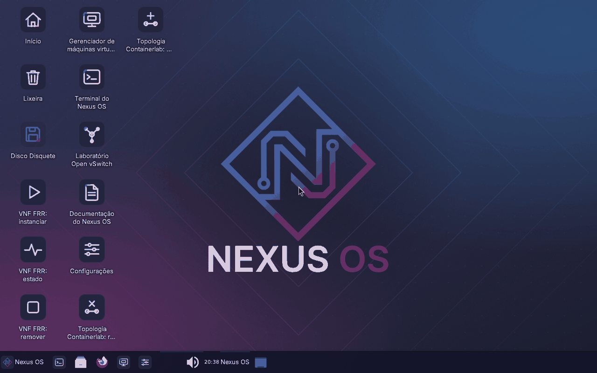

# Manual v1 do Nexus OS (RC2, núcleo e ambiente gráfico)

Manual de instalação, boot e uso de cada componente da ISO. Cobre o núcleo (RC1) e, a partir da RC2, o ambiente gráfico.
Os blocos marcados `bash nexus-exec` são executados por `tests/manual.sh` dentro da ISO, sem rede, em ordem, e cada um limpa o que criou. Os demais blocos são exemplos que o teste não executa.
Roteiro para quem vai executar o manual do zero: [checklist-teste-documentacao.md](checklist-teste-documentacao.md), parte "Manual v1 por componente".

## Visão geral

O Nexus OS é uma remasterização do Debian 13 (trixie) gerada com live-build. A ISO é *live*: roda na memória, sem instalar nada no disco. Traz, já instalados e testados, os componentes para laboratórios de redes definidas por software (SDN) e de virtualização de funções de rede (NFV).

| Componente | Comando | Seção |
| --- | --- | --- |
| Open vSwitch (SDN) | `nexus-sdn up\|flows\|down` | Open vSwitch (nexus-sdn) |
| KVM/QEMU e libvirt (VIM) | `nexus-vm criar\|listar\|remover` | libvirt (nexus-vm) |
| Docker e imagem FRR offline | `docker` | Contêineres e imagens offline |
| FRRouting (VNF) | `vtysh` | FRRouting |
| Containerlab | `containerlab deploy\|destroy` | Containerlab |
| Orquestração NFVO/VNFM simplificada | `nexus-vnf up\|status\|down` | Orquestração (nexus-vnf) |
| Testes dentro da ISO | `nexus-smoke <nome>\|all` | Testes (nexus-smoke) |
| Desktop XFCE e atalhos | login automático do `user` | Ambiente gráfico |

O ambiente gráfico entra na RC2. Fora da ISO: OpenDaylight (opcional, trabalho futuro) e GNS3, que só é documentado e não entra na ISO ([gns3.md](gns3.md)). Arquitetura: [README.md](../README.md).

## Gerar a ISO

A ISO só se constrói em Linux (VM Debian 13), com `sudo`, Docker e internet. Passo a passo, tempo e espaço em disco: seção "Como gerar a ISO" do [README.md](../README.md) e [ambiente-de-build.md](ambiente-de-build.md). Em resumo, na raiz do repositório clonado na VM:

```bash
sudo scripts/build-iso.sh
tests/iso.sh dist/nexus-os-poc-amd64.iso
```

O build gera `dist/nexus-os-poc-amd64.iso` e o `.sha256`. A RC1 validada é a cópia `dist/nexus-os-rc1-amd64.iso` (identificação e SHA256 em [rc1.md](rc1.md)). A ISO e o `.sha256` não vão para o Git.

## Iniciar a ISO

Use pelo menos **1536 MiB de RAM** com a ISO da RC1 e **2560 MiB** com a da RC2, que tem o desktop ([requisitos.md](requisitos.md)). A ISO tem boot BIOS (isolinux), então no Hyper-V use VM de Geração 1. Na tela do isolinux, aperte Enter.

**QEMU no Linux** (com KVM se `/dev/kvm` existir; sem `-enable-kvm -cpu host` a emulação por software é bem mais lenta):

```bash
qemu-system-x86_64 -enable-kvm -cpu host -m 2048 -smp 2 -cdrom dist/nexus-os-rc1-amd64.iso -boot d
```

Os testes do repositório usam estas mesmas opções com `-display none` e a serial em arquivo (`tests/iso.sh` e `tests/iso-smoke.sh`). A janela do QEMU não foi exercitada nesta versão do manual.

**Hyper-V no Windows** (PowerShell como administrador; ISO copiada para `C:\HyperV`, fora do repositório). Procedimento validado em [rc1.md](rc1.md), seção "Boot no Hyper-V":

```powershell
$vm = "nexus-rc1-lab"
New-VM -Name $vm -Generation 1 -MemoryStartupBytes 4096MB -BootDevice CD -NoVHD
Set-VMProcessor -VMName $vm -Count 2
Set-VMMemory -VMName $vm -DynamicMemoryEnabled $false -StartupBytes 4096MB
Add-VMDvdDrive -VMName $vm -Path "C:\HyperV\nexus-os-rc1-amd64.iso"
Start-VM -Name $vm
vmconnect.exe localhost $vm
```

Essa VM nasce sem rede e sem KVM. Para a VM de build com KVM, veja [hyperv.md](hyperv.md). O VirtualBox serve só como VM sem KVM: em CPU AMD o KVM aninhado derruba a VM (issue 25).

## Login de laboratório

A sessão do usuário `user` abre sozinha no console. Se pedir login: usuário `user`, senha `live` (credencial pública da Debian Live, de laboratório). O `sudo` não pede senha e `user` está no grupo `libvirt`. Não há hardening de produção.

Confira o sistema e os comandos do Nexus OS:

```bash nexus-exec
grep -qw 'boot=live' /proc/cmdline
cat /etc/debian_version
for c in nexus-sdn nexus-vm nexus-vnf nexus-smoke containerlab docker vtysh virsh ovs-vsctl; do
    command -v "$c" >/dev/null || { echo "FALHA: comando ausente: $c"; exit 1; }
done
ls /usr/share/nexus-os
```

Saída esperada: a versão do Debian (começa com 13) e a lista `docs labs nfv sdn tests` em `/usr/share/nexus-os`.

## Open vSwitch (nexus-sdn)

Bridge `br-nexus` em modo `secure`, sem controlador, e dois namespaces (`h1` e `h2`). Sem as regras de `sdn/flows/basico.flows` a bridge descarta tudo. Detalhes: [sdn.md](sdn.md).

```bash nexus-exec
sudo nexus-sdn up
sudo ovs-vsctl get-fail-mode br-nexus
sudo ovs-ofctl dump-flows br-nexus
sudo ip netns exec h1 ping -c 2 192.0.2.2
sudo ovs-ofctl del-flows br-nexus
if sudo ip netns exec h1 ping -c 2 -W 2 192.0.2.2 >/dev/null 2>&1; then
    echo "FALHA: o ping passou sem as regras"
    exit 1
fi
sudo nexus-sdn flows
sudo ip netns exec h1 ping -c 2 192.0.2.2
sudo nexus-sdn down
```

Saída esperada: `secure`, quatro regras no `dump-flows`, `0% packet loss` no primeiro e no último ping e perda total com as regras removidas.

## libvirt (nexus-vm)

O `nexus-vm` define e inicia uma VM de teste (128 MiB, sem disco) em `qemu:///system`. Usa `virt-type kvm` se existir `/dev/kvm` e `qemu` (emulação) se não. Detalhes: [virtualizacao.md](virtualizacao.md).

```bash nexus-exec
nexus-vm criar manual1
nexus-vm listar
estado=$(LC_ALL=C virsh -c qemu:///system domstate manual1)
echo "estado: $estado"
[ "$estado" = running ]
nexus-vm remover manual1
if LC_ALL=C virsh -c qemu:///system dominfo manual1 >/dev/null 2>&1; then
    echo "FALHA: manual1 ainda existe"
    exit 1
fi
```

Saída esperada: `OK: VM manual1 criada e iniciada (virt-type kvm)` (ou `qemu`), a VM `running` na listagem e `OK: VM manual1 removida`.

## Contêineres e imagens offline

A ISO traz o Docker e a imagem `quay.io/frrouting/frr:10.7.1` dentro dela. No boot, o `nexus-images.service` carrega a imagem sem rede. Os dados do Docker ficam em memória e somem a cada boot. Detalhes: [containers.md](containers.md).

```bash nexus-exec
sudo systemctl is-active nexus-images.service
driver=$(sudo docker info --format '{{.Driver}}')
echo "driver: $driver"
[ "$driver" = overlay2 ]
sudo docker image inspect quay.io/frrouting/frr:10.7.1 --format '{{.Id}}'
versao=$(sudo docker run --rm --network none --entrypoint /usr/lib/frr/zebra quay.io/frrouting/frr:10.7.1 --version)
echo "$versao"
[[ $versao == *10.7.1* ]]
```

Saída esperada: `active`, `overlay2`, o identificador da imagem e `zebra version 10.7.1_git`.

## FRRouting

A ISO traz o pacote `frr` do Debian, com o serviço habilitado. O pacote vem com o `ospfd` desligado; a configuração de exemplo (`/usr/share/nexus-os/nfv/frr/exemplo`) liga o `ospfd` e anuncia o loopback 198.51.100.10/32 na área 0 do OSPF. O bloco abaixo aplica o exemplo e restaura os arquivos originais no fim. Detalhes: [nfv.md](nfv.md).

```bash nexus-exec
versao=$(sudo vtysh -c 'show version')
echo "${versao%%$'\n'*}"
[[ $versao == FRRouting* ]]
copia=$(mktemp -d)
sudo cp -a /etc/frr/daemons /etc/frr/frr.conf "$copia/"
exemplo=/usr/share/nexus-os/nfv/frr/exemplo
sudo install -m 0640 -o frr -g frr "$exemplo/daemons" /etc/frr/daemons
sudo install -m 0640 -o frr -g frr "$exemplo/frr.conf" /etc/frr/frr.conf
sudo systemctl restart frr
ok=nao
for i in $(seq 1 30); do
    conf=$(sudo vtysh -c 'show running-config' 2>/dev/null || true)
    if [[ $conf == *"ip address 198.51.100.10/32"* && $conf == *"router ospf"* ]]; then ok=sim; break; fi
    sleep 2
done
echo "exemplo aplicado: $ok"
sudo cp -a "$copia/daemons" "$copia/frr.conf" /etc/frr/
sudo systemctl restart frr
rm -rf "$copia"
[ "$ok" = sim ]
```

Saída esperada: `FRRouting 10.3` na primeira linha e `exemplo aplicado: sim`.

## Containerlab

Um comando sobe a topologia de demonstração: dois nós FRR (`r1` e `r2`, imagem já na ISO) trocando rotas por OSPF. O Containerlab precisa de root. Sem rede, o `deploy` imprime `Failed fetching latest version information`, que não afeta o resultado. O `vtysh` imprime o aviso `Can't open configuration file /etc/frr/vtysh.conf`, também inofensivo. Detalhes: [nfv.md](nfv.md).

```bash nexus-exec
topo=/usr/share/nexus-os/labs/containerlab/frr-duo.clab.yml
sudo containerlab deploy -t "$topo"
r1=nao
r2=nao
for i in $(seq 1 40); do
    rotas1=$(sudo docker exec clab-frr-duo-r1 vtysh -c 'show ip route ospf' 2>/dev/null || true)
    rotas2=$(sudo docker exec clab-frr-duo-r2 vtysh -c 'show ip route ospf' 2>/dev/null || true)
    [[ $rotas1 == *198.51.100.2/32* ]] && r1=sim
    [[ $rotas2 == *198.51.100.1/32* ]] && r2=sim
    if [ "$r1" = sim ] && [ "$r2" = sim ]; then break; fi
    sleep 3
done
echo "$rotas1"
echo "$rotas2"
sudo containerlab destroy -t "$topo" --cleanup
[ "$r1" = sim ] && [ "$r2" = sim ]
```

Saída esperada: `O>* 198.51.100.2/32` em `r1` e `O>* 198.51.100.1/32` em `r2`. A convergência levou de 12 s a 16 s nas medições.

## Orquestração (nexus-vnf)

O `nexus-vnf` é o NFVO/VNFM simplificado: instancia a VNF FRR (nó `vnf1`, Containerlab com contêiner FRR), consulta o estado e remove. `up` e `down` podem ser repetidos sem efeito colateral. Detalhes: [nfv.md](nfv.md).

```bash nexus-exec
sudo nexus-vnf up
sudo nexus-vnf status
sudo nexus-vnf down
if sudo nexus-vnf status >/dev/null 2>&1; then
    echo "FALHA: status devia sair com 1 depois do down"
    exit 1
fi
```

Saída esperada: `OK: VNF vnf1 rodando` no `status` com a VNF no ar, e código de saída 1 no `status` depois do `down`.

## Testes (nexus-smoke)

O `nexus-smoke` roda dentro da ISO os testes de `/usr/share/nexus-os/tests`, na ordem de `smoke.list`, e imprime a RAM usada. Só root.

```bash
sudo nexus-smoke all > /tmp/smoke.txt 2>&1
grep -a -e NEXUS-SMOKE-END -e NEXUS-SMOKE-DONE -e NEXUS-SMOKE-MEMPEAK /tmp/smoke.txt
```

Saída esperada: oito linhas `NEXUS-SMOKE-END <nome> 0` e `NEXUS-SMOKE-DONE 8 0`. Este bloco não é executado por `tests/manual.sh`, porque o teste do manual já roda dentro do `nexus-smoke`. O bloco abaixo confere que o runner e a lista existem:

```bash nexus-exec
test -x /usr/local/bin/nexus-smoke
[ "$(wc -l < /usr/share/nexus-os/tests/smoke.list)" -eq 8 ]
grep -qx orquestracao /usr/share/nexus-os/tests/smoke.list
grep -qx desktop /usr/share/nexus-os/tests/smoke.list
```

Para rodar os smokes de fora, na VM de build, sem rede: `tests/iso-smoke.sh dist/nexus-os-rc1-amd64.iso all` ([integracao-iso.md](integracao-iso.md)).

## Ambiente gráfico

A RC2 inicia direto no desktop XFCE: o `lightdm` abre a sessão do usuário `user` sozinho (login automático), sem pedir senha. O console serial e os testes sem janela continuam funcionando. Escolha do desktop, medições e limitações: [gui.md](gui.md). Nome, marca, papel de parede e licenças: [branding.md](branding.md).



### Iniciar com vídeo

Use pelo menos a RAM recomendada com o desktop em [requisitos.md](requisitos.md), seção "Com ambiente gráfico". A ISO da RC2 se chama `nexus-os-rc2-amd64.iso` ([rc2.md](rc2.md)).

**QEMU no Linux, com janela** (`-vga std` é o vídeo que os testes usam; sem `-enable-kvm -cpu host` a emulação por software leva minutos até a sessão):

```bash
qemu-system-x86_64 -enable-kvm -cpu host -m 2560 -smp 2 -vga std -cdrom dist/nexus-os-rc2-amd64.iso -boot d
```

O menu de boot do Nexus OS inicia sozinho em 5 segundos (Enter adianta). A janela do QEMU em si não foi exercitada pelos testes (eles usam `-display none` e a captura de tela do monitor do QEMU); a sessão foi verificada por `loginctl` e pelas capturas de `docs/img/`.

**Hyper-V no Windows** (PowerShell como administrador; ISO em `C:\HyperV`). Mesmo procedimento da seção "Iniciar a ISO", com a ISO da RC2 e pelo menos 2560 MB de memória estática:

```powershell
$vm = "nexus-rc2-lab"
New-VM -Name $vm -Generation 1 -MemoryStartupBytes 2560MB -BootDevice CD -NoVHD
Set-VMProcessor -VMName $vm -Count 2
Set-VMMemory -VMName $vm -DynamicMemoryEnabled $false -StartupBytes 2560MB
Add-VMDvdDrive -VMName $vm -Path "C:\HyperV\nexus-os-rc2-amd64.iso"
Connect-VMNetworkAdapter -VMName $vm -SwitchName "Default Switch"
Start-VM -Name $vm
vmconnect.exe localhost $vm
```

**Internet na VM do Hyper-V:** o `New-VM` com `-NoVHD` cria a VM sem placa de rede conectada, e sem ela o Firefox acusa `NS_ERROR_OFFLINE` e a barra não oferece rede nenhuma. O `Connect-VMNetworkAdapter` acima liga a VM ao `Default Switch` (NAT do Windows, com DHCP e internet); se a VM já existe, rode só essa linha com a VM desligada ou ligada. Se o comando acusar que a VM não tem adaptador de rede, use antes `Add-VMNetworkAdapter -VMName $vm`. No QEMU, sem rede por padrão no `-nic none` dos testes, use `-nic user` para ter internet.

A ISO tem boot BIOS e UEFI (`xorriso -indev <iso> -report_el_torito plain`), então a Geração 2 deveria servir; só a Geração 1 foi validada. Na Geração 1, a ISO final (SHA256 `c1a1d5c2...0eba`) subiu sozinha no Hyper-V Geração 1 (2560 MB, 2 vCPU, `Default Switch`) em 28/10/2026, conferida por um integrante do grupo a partir de capturas de tela: menu de boot, desktop em janela de 1024x768 (limite do vídeo da Geração 1), barra inferior, hora de Brasília, internet no Firefox, LibreOffice Writer em português, `.md` no Mousepad, tecla Print e teclado ABNT2. Falha conhecida: o ícone "Disco Disquete" (hardware virtual da Geração 1, sem mídia) dá `Error mounting /dev/fd0 ... Can't open blockdev` ao ser aberto; a correção está pendente (issue 55). O roteiro humano completo da parte H do [checklist](checklist-teste-documentacao.md) segue pendente. Sem KVM a sessão leva alguns minutos para aparecer.

### O que há no desktop

- Barra única embaixo, como a do Windows: botão "Nexus OS" (menu com todos os aplicativos), lançadores (terminal, arquivos, Firefox, máquinas virtuais, configurações), a lista das janelas abertas, a bandeja com o applet de rede, o som, o relógio e o usuário. Não há barra em cima nem seletor de áreas de trabalho.
- Gerenciador de arquivos (Thunar), terminal gráfico (Xfce Terminal), navegador (Firefox ESR), configuração de rede (NetworkManager) e de vídeo (Configurações do Xfce).
- Programas prontos para uso, sem instalar nada: LibreOffice (Writer, Calc e Impress), Mousepad (texto e `.md`), Evince (PDF), Ristretto (imagens), File Roller (zip e tar), Calculadora, VLC, GIMP, Inkscape, KeePassXC, Wireshark (captura sem `sudo`, o `user` está no grupo `wireshark`), Remmina, e no terminal `tcpdump`, `iperf3`, `mtr`, `nmap`, `traceroute`, `dig`, `nc`, `curl`, `wget`, `tmux`, `htop`, `vim` e `git`. A lista completa e o tamanho de cada grupo estão em [gui.md](gui.md), seção "Programas incluídos".
- Português do Brasil, teclado ABNT2, horário de Brasília (`America/Sao_Paulo`) e nome de máquina `nexus-os`. A tela não apaga nem bloqueia.
- Tecla Print: captura de tela (`xfce4-screenshooter`).
- Menu "Nexus OS" e dez atalhos na área de trabalho, descritos abaixo.
- Papel de parede, tema escuro Nexus-Dark (na paleta da logo), ícones do tema Nexus (sobre o Papirus-Dark, com pasta pessoal, lixeira e unidades no estilo do projeto), fonte Inter e tela de login com a logo original do Nexus OS. O sistema continua sendo o Debian: `/etc/os-release` não muda.

### Atalhos

| Atalho | O que faz |
| --- | --- |
| Terminal do Nexus OS | Abre o terminal gráfico |
| Gerenciador de máquinas virtuais | Abre o `virt-manager` conectado ao `qemu:///system` |
| Laboratório Open vSwitch | Executa `sudo nexus-sdn up` em um terminal (a remoção é `sudo nexus-sdn down`) |
| VNF FRR: instanciar | Executa `sudo nexus-vnf up` |
| VNF FRR: estado | Executa `sudo nexus-vnf status` |
| VNF FRR: remover | Executa `sudo nexus-vnf down` |
| Topologia Containerlab: criar | Executa `containerlab deploy` da topologia de dois nós FRR |
| Topologia Containerlab: remover | Executa `containerlab destroy --cleanup` da mesma topologia |
| Documentação do Nexus OS | Abre a documentação em HTML (`/usr/share/nexus-os/docs-html/index.html`) no Firefox, sem internet |
| Configurações | Abre o gerenciador de configurações do Xfce (rede, aparência, teclado, vídeo) |

Os atalhos de terminal mostram a saída, o código de saída e esperam Enter para fechar a janela. Tudo o que um atalho cria vive na RAM e some ao desligar a ISO.

### Verificar a sessão

Os blocos abaixo rodam dentro da ISO como `root` (o `tests/manual.sh` os executa com a sessão do `user` já ativa). O primeiro define a função `como_user`, que os seguintes usam: execute-os em ordem, no mesmo terminal.

```bash nexus-exec
systemctl is-active lightdm
for i in $(seq 1 60); do
    pgrep -u user -x xfce4-panel >/dev/null && pgrep -u user -x xfwm4 >/dev/null && break
    sleep 2
done
sessao=$(loginctl list-sessions --no-legend | awk '$3 == "user" {print $1; exit}')
[ "$(loginctl show-session "$sessao" -p Type --value)" = x11 ]
[ "$(loginctl show-session "$sessao" -p State --value)" = active ]
for p in xfce4-session xfce4-panel xfwm4 xfdesktop; do
    pgrep -u user -x "$p" >/dev/null
done
uid=$(id -u user)
pid=$(pgrep -u user -x xfce4-session | head -n 1)
amb() { tr '\0' '\n' <"/proc/$pid/environ" | sed -n "s/^$1=//p" | head -n 1; }
tela=$(amb DISPLAY)
xauth=$(amb XAUTHORITY)
bus=$(amb DBUS_SESSION_BUS_ADDRESS)
como_user() {
    runuser -u user -- env HOME=/home/user DISPLAY="$tela" ${xauth:+XAUTHORITY="$xauth"} \
        XDG_RUNTIME_DIR="/run/user/$uid" DBUS_SESSION_BUS_ADDRESS="$bus" NEXUS_ATALHO_TESTE=1 "$@"
}
echo "sessão $sessao de user ativa, tela $tela"
```

Saída esperada: `active` do `lightdm` e `sessão <n> de user ativa, tela :0`.

Identidade visual e base Debian:

```bash nexus-exec
test -f /usr/share/backgrounds/nexus-os/papel-de-parede.png
imagem=$(como_user xfconf-query -c xfce4-desktop -p /backdrop/screen0/monitor0/workspace0/last-image)
[ "$(readlink -f "$imagem")" = /usr/share/backgrounds/nexus-os/papel-de-parede.png ]
[ "$(como_user xfconf-query -c xsettings -p /Net/ThemeName)" = Nexus-Dark ]
[ "$(como_user xfconf-query -c xfce4-panel -p /plugins/plugin-1/button-title)" = "Nexus OS" ]
grep -qx 'ID=debian' /etc/os-release
```

Barra inferior, idioma e programas (a barra tem a lista de janelas e não tem o seletor de áreas de trabalho; o sistema está em português do Brasil, com o nome de máquina `nexus-os`; os programas e a documentação em HTML existem):

```bash nexus-exec
plugins=$(como_user xfconf-query -c xfce4-panel -lv | awk '$1 ~ /^\/plugins\/plugin-[0-9]+$/ {print $2}')
grep -qx tasklist <<<"$plugins"
[ -z "$(grep -x pager <<<"$plugins")" ]
[ "$(hostname)" = nexus-os ]
grep -qx 'LANG=pt_BR.UTF-8' /etc/default/locale
for c in soffice mousepad evince ristretto vlc wireshark gimp inkscape keepassxc xfce4-screenshooter; do
    command -v "$c" >/dev/null
done
test -f /usr/share/nexus-os/docs-html/index.html
echo "barra, idioma e programas ok"
```

Saída esperada: `barra, idioma e programas ok`.

Atalhos: os dez existem no menu e na área de trabalho, são idênticos e válidos.

```bash nexus-exec
[ "$(ls /usr/share/applications/nexus-*.desktop | wc -l)" -eq 10 ]
[ "$(ls /home/user/Desktop/nexus-*.desktop | wc -l)" -eq 10 ]
for a in /usr/share/applications/nexus-*.desktop; do
    desktop-file-validate "$a"
    cmp "$a" "/home/user/Desktop/$(basename "$a")"
    grep -m1 '^Name=' "$a"
done
```

Saída esperada: dez linhas `Name=`, sem mensagem de erro.

Os seis atalhos de terminal, lançados como o `user` dentro da sessão com `NEXUS_ATALHO_TESTE=1` (o `nexus-atalho` não espera Enter), cada um com código de saída 0, e a limpeza de tudo o que criaram:

```bash nexus-exec
for id in nexus-sdn-lab nexus-vnf-up nexus-vnf-status nexus-vnf-down nexus-clab-deploy nexus-clab-destroy; do
    nome=$(grep -m1 '^Exec=' "/usr/share/applications/$id.desktop" \
        | awk '{for (i = 1; i < NF; i++) if ($i == "nexus-atalho") {print $(i + 1); exit}}')
    estado="/run/user/$uid/nexus-atalho-$nome.status"
    rm -f "$estado"
    como_user gtk-launch "$id"
    for i in $(seq 1 90); do
        [ -s "$estado" ] && break
        sleep 1
    done
    [ "$(cat "$estado")" = 0 ]
    echo "$id: código 0"
    [ "$id" != nexus-sdn-lab ] || sudo nexus-sdn down >/dev/null
done
sudo nexus-vnf down >/dev/null
sudo containerlab destroy -t /usr/share/nexus-os/labs/containerlab/frr-duo.clab.yml --cleanup >/dev/null 2>&1 || true
[ -z "$(docker ps -aq)" ]
```

Saída esperada: seis linhas `<atalho>: código 0`.

### Problemas no desktop

| Sintoma | Causa | Correção |
| --- | --- | --- |
| Tela preta ou sem janela do QEMU | O QEMU foi iniciado com `-display none` | Tire o `-display none` (a janela abre sozinha) e use `-vga std` |
| Demora a sair do menu de boot | O menu tem contagem de 5 segundos | Aperte Enter para adiantar |
| A sessão demora muito para aparecer | Sem KVM a emulação é lenta (cerca de 259 s medidos com 1 vCPU, [gui.md](gui.md)) | Use um host com KVM ou espere |
| Docker não carrega a imagem FRR | O tmpfs do Docker é 50% da RAM | Dê pelo menos a RAM recomendada ([requisitos.md](requisitos.md)) |
| Atalho de terminal fecha a janela sem mostrar nada | O comando terminou com erro antes da saída | Rode o mesmo comando no Terminal do Nexus OS e veja a mensagem |
| Atalho do laboratório Open vSwitch cria, mas não remove | O atalho só faz `nexus-sdn up` | No terminal, `sudo nexus-sdn down` |
| Ícone de rede não aparece na barra | Sem rede, o applet fica sem ícone ativo | Confira por `pgrep -u user nm-applet` |
| Firefox diz que está offline e a barra não lista redes | A VM do Hyper-V foi criada sem placa de rede conectada | Com o PowerShell como administrador: `Connect-VMNetworkAdapter -VMName <vm> -SwitchName "Default Switch"` |
| Tecla Print não faz nada | Versões antes da rodada 3 da RC2 não tinham o `xfce4-screenshooter` | Use a ISO atual |
| "Falha ao montar Disco Disquete" (`Can't open blockdev`) | O Hyper-V Geração 1 tem um disquete virtual sem mídia; o ícone aparece e não monta | Ignore: não afeta o sistema. Correção pendente (issue 55) |
| O papel de parede mudou | O `user` trocou nas configurações | Reinicie a ISO: a sessão volta ao padrão do Nexus OS |

## Requisitos

RAM recomendada 1536 MiB para o núcleo (RC1) e **2560 MiB com o desktop (RC2)**; o mínimo medido é 896 MiB sem desktop (o Docker precisa carregar a imagem FRR) e 1792 MiB com desktop (menos que isso o `all` falha). Disco do guest não é usado (a live roda na memória); a ISO da RC2 ocupa 1693 MiB de mídia. Tabelas medidas e método: [requisitos.md](requisitos.md).

## Solução de problemas

| Sintoma | Causa | Correção |
| --- | --- | --- |
| Boot muito lento | Sem `/dev/kvm` o QEMU emula a CPU | Use um host com KVM (Hyper-V com virtualização aninhada, [hyperv.md](hyperv.md)); sem KVM, espere mais |
| `docker image ls` vazio logo após o boot | O `nexus-images.service` ainda carrega a imagem (poucos segundos) | `sudo systemctl status nexus-images.service`; espere ficar `active` |
| `docker load` falha por falta de espaço | Menos de cerca de 896 MiB de RAM; o Docker usa tmpfs (issue 31) | Dê 1536 MiB ou mais à VM |
| `Failed fetching latest version information` no `containerlab deploy` | Sem rede, o Containerlab não consulta a versão | Ignore: a topologia sobe normalmente |
| `Can't open configuration file /etc/frr/vtysh.conf` | Aviso do `vtysh` | Ignore: a configuração está aplicada |
| `show ip route ospf` sem rotas logo depois do `deploy` | O OSPF leva alguns segundos para convergir | Repita o comando depois de 15 s |
| Ping entre `h1` e `h2` falha | As regras OpenFlow foram removidas (modo `secure`) | `sudo nexus-sdn flows` recarrega as regras |
| `nexus-smoke libvirt` falhou uma vez (`domínio smoke1 nao existe`) | Falha intermitente conhecida, causa não confirmada (issue 35) | Rode o teste de novo e registre a ocorrência |
| Ao desligar, a live pede ENTER | Comportamento da live (issue 34) | Aperte Enter no console |
| Sobrou laboratório depois de uma falha | Um comando parou no meio | `sudo nexus-sdn down`, `nexus-vm remover <nome>`, `sudo nexus-vnf down`, `sudo containerlab destroy -t <topologia> --cleanup` |

## Verificação

Na VM de build, sem rede e fora do manual:

```bash
tests/docs.sh
tests/manual.sh dist/nexus-os-rc1-amd64.iso
```

Saída esperada: `OK: tests/docs.sh ...` e `OK: tests/manual.sh ...` (com o número de blocos executados dentro da ISO e o modo, com ou sem KVM). Cada falha ou limitação encontrada ao seguir o manual vira uma issue ([checklist-teste-documentacao.md](checklist-teste-documentacao.md), parte E).
